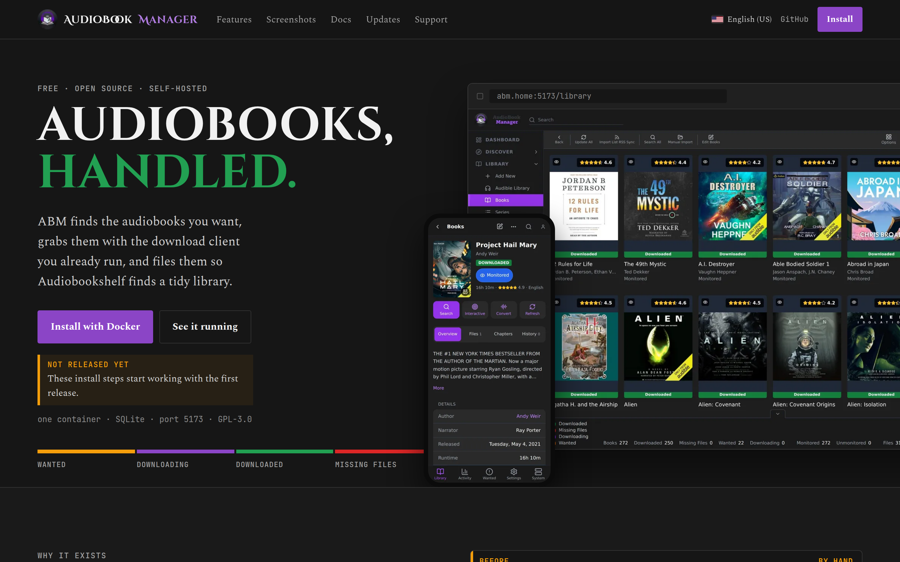
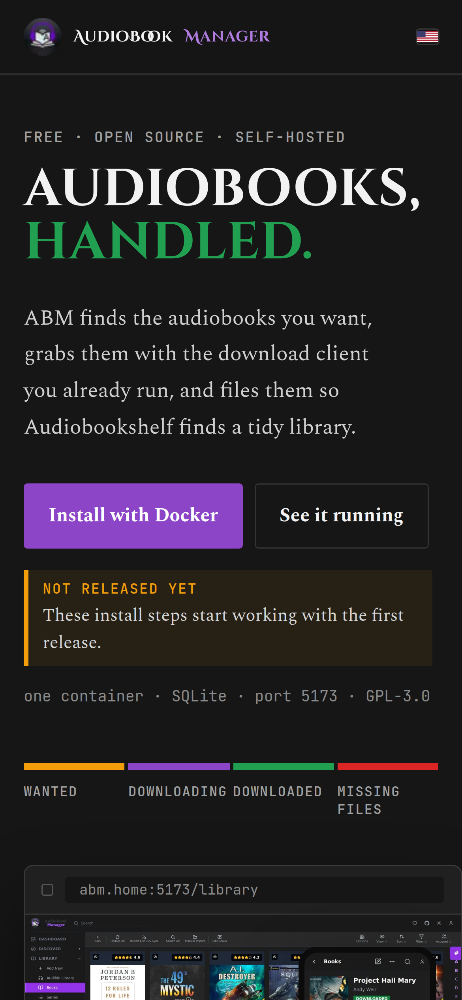
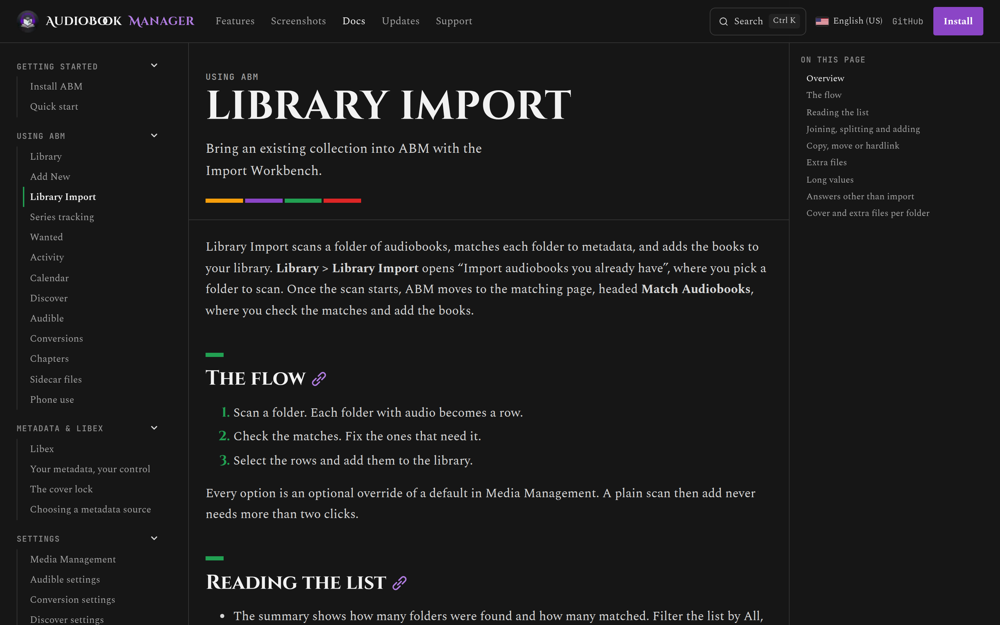

<p align="center">
  <picture>
    <source media="(prefers-color-scheme: dark)" srcset="docs/readme/abm-wordmark-dark.svg">
    <source media="(prefers-color-scheme: light)" srcset="docs/readme/abm-wordmark-light.svg">
    
  </picture>
</p>

<p align="center"><b>The website, docs and release notes for AudioBook Manager.</b></p>

<p align="center">
  <a href="https://github.com/sunbrolynk/audiobookmanager.com/actions/workflows/site-checks.yml"></a>
  <a href="LICENSE"></a>
</p>

The source for [audiobookmanager.com](https://audiobookmanager.com): the website,
documentation and release notes for [AudioBook Manager](https://github.com/sunbrolynk/AudioBook-Manager)
(ABM), my self-hosted audiobook manager in the style of Sonarr and Radarr.

It's an [Astro](https://astro.build) site with [Starlight](https://starlight.astro.build)
for the docs. It's static, with no analytics and no third-party scripts or fonts, and
Cloudflare Pages builds and serves it. The one piece of server code is a small
Pages Function that serves the [ABM Radio](https://radio.audiobookmanager.com)
pages on their own host.

- Community and help: [Discord](https://discord.gg/qeJRrM6AZ) or
  [support@audiobookmanager.com](mailto:support@audiobookmanager.com)
- Problems with the app itself: [ABM's issues](https://github.com/sunbrolynk/AudioBook-Manager/issues)
- Problems with the site or a translation: this repository's issues

## Running it locally

You need Node.js 24 (CI uses 24.14.1) and npm 11.

```sh
npm ci --ignore-scripts
npm run dev
```

The dev server prints a local address. The other commands:

| Command | What it does |
|---|---|
| `npm run build` | Checks the languages and the API reference, builds into `dist/`, fills the CSP hashes in `dist/_headers`, then fails if any page loads something that policy blocks |
| `npm run preview` | Serves the built `dist/` |
| `npm test` | The regression tests (`node --test`) |
| `npm run typecheck` | Generates Astro's content types and type-checks `src/` and `astro.config.mjs` with `tsc` |
| `node scripts/check-links.mjs` | Checks every internal link and anchor in `dist/` |
| `node scripts/check-overflow.mjs` | Loads every built page at widths from 320 to 1920px and fails if one scrolls sideways. Needs `npx playwright install chromium` once |

## The site

<table>
  <tr>
    <td width="68%"></td>
    <td width="32%"></td>
  </tr>
  <tr>
    <td colspan="2"></td>
  </tr>
</table>

## What's where

| Path | Holds |
|---|---|
| `src/content/docs/` | The English docs at the top level, and one folder per translated language |
| `src/content/releases/`, `public/releases.json` | Release notes, generated from ABM's changelog by `scripts/build-releases.mjs` |
| `src/components/` | The landing page, the shared header and footer, and Starlight overrides |
| `src/styles/` | Design tokens and page styles |
| `src/landing-strings.json`, `src/ui-strings.json`, `src/sidebar-labels.json` | Landing, header, footer and sidebar text for every language |
| `src/locales.json` | The languages that are live. A language goes in only once every page is translated |
| `src/assets/screens/` | App screenshots, captured by `scripts/capture-screens.mjs` |
| `public/_headers` | Security headers and the Content-Security-Policy template |
| `public/api-reference/` | ABM's API reference (ReDoc and the OpenAPI schema) |
| `scripts/` | Build checks, git hooks, and the release and screenshot tools |

## Contributing

Fixes are welcome. Make a branch, run the build and the checks above, and open
a PR into `main` saying what was wrong and how you checked the fix.
[CONTRIBUTING.md](CONTRIBUTING.md) has the details, including how I review
dependency updates.

Translations have their own flow, with a review PR, an issue and a Discord
thread for each language. [TRANSLATING.md](TRANSLATING.md) covers sending a
correction and adding a language.

## Maintaining and rebuilding

[MAINTAINING.md](MAINTAINING.md) has everything needed to stand the site up from
nothing: the git hooks, the Cloudflare Pages project, Access, the domain and
email, the Discord webhook, the GitHub settings, and the routine jobs
(screenshots, release notes, the API reference, dependency updates).

## License

GNU General Public License v3.0, the same as ABM. See [LICENSE](LICENSE).
