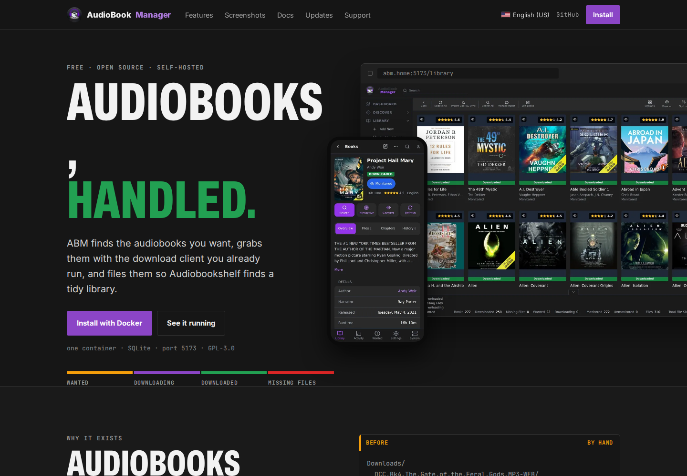
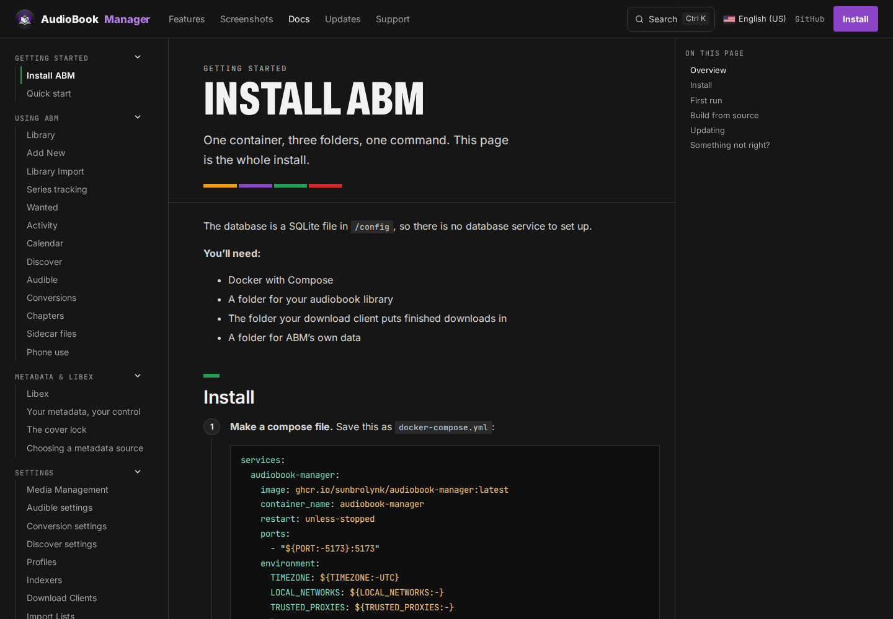

# audiobookmanager.com

Source for the AudioBook Manager website: its landing page, installation and
usage guides, release notes, and community-maintained website translations.

Built with Astro and Starlight, the site generates static files for deployment
to Cloudflare Pages. Running the website does not require an AudioBook Manager
instance or a database.

- [Website](https://audiobookmanager.com)
- [AudioBook Manager application](https://github.com/sunbrolynk/AudioBook-Manager)
- [Community on Discord](https://discord.gg/9TS4gzYCQZ)
- [Application bug reports](https://github.com/sunbrolynk/AudioBook-Manager/issues)

Use this repository for website code, documentation, and translation changes.
See [CONTRIBUTING.md](CONTRIBUTING.md) for contribution and review guidance.

## Website preview

### Landing page



### Documentation



## Local development

Use Node.js 24.14.1, matching GitHub Actions and the configured Cloudflare
build environment. Local development has been tested with npm 11.

Review unfamiliar code before installing, testing, or building it.

```sh
npm ci --ignore-scripts
npm run dev
```

Open the local URL printed by Astro. To validate and preview the static build:

```sh
npm test
npm run build
node scripts/check-links.mjs
npm run preview
```

The build checks locale completeness and placeholders, generates the website
and search index, and writes CSP hashes into `dist/_headers`.

The local preview is useful for checking layout and navigation. Verify
Cloudflare response headers separately on an actual deployment.

## Tests and checks

`npm test` runs the regression suite using Node's built-in test runner.
Tests cover translated formatting, Markdown URLs, translation structure and
placeholders, locale validation, HTML parsing, internal links, and CSP generation.

GitHub Actions also installs locked dependencies, audits known vulnerabilities,
scans Git history for secrets, builds the site, and checks internal links.

To install the local pre-push checks, first review the hook scripts, then run:

```sh
bash scripts/install-hooks.sh
```

The hook requires Bash, Node.js, npm, and a running Docker daemon. It checks
the outgoing commit against the checked-out commit, requires a clean working
tree, and runs secret scanning, locked dependency installation, vulnerability
auditing, regression tests, the build, and link validation.

Install the hook separately in each clone. The installer refuses to replace
a different existing hook or change a custom hooks-directory configuration.
When the tracked hook changes, review the differences before updating your
installed copy.

Local hooks can be bypassed. Required GitHub checks and branch rules must be
configured and their enforcement verified separately.

## Cloudflare Pages deployment

Connect this repository to a Cloudflare Pages project using these settings:

| Setting | Value |
| --- | --- |
| Production branch | `main` |
| Root directory | Repository root; leave unset |
| Build command | `npm test && npm run build && node scripts/check-links.mjs` |
| Build output directory | `dist` |
| `NODE_VERSION` | `24.14.1` |
| `npm_config_ignore_scripts` | `true` |

Apply the build variables to both production and preview builds. Confirm
their effective values in deployment logs when configuring a new project.

The static website needs no application credentials, database connections,
or resource bindings. The Discord announcement webhook belongs in GitHub
Actions secrets, not in the website's build environment.

Review changes through pull requests and inspect their preview deployments
before merging. With automatic production deployments enabled, merging into
`main` triggers a production build.

Deploy the complete generated `dist/` directory, including `_headers`.
Do not deploy `public/` alone or substitute a direct `astro build` command:
`npm run build` also performs validation and generates the CSP hashes.

After deployment, check the landing page, documentation, search, language
switching, and response headers. Passing a build does not verify browser
behavior or hosting configuration.

## Translations

A locale is published only after its documentation, landing page, navigation,
and footer strings are complete. Complete AI translations qualify; human
review is encouraged but is not required before publication.

Release notes intentionally remain in English across all locales.
Incomplete languages remain in private preparation.

The enabled locales are recorded in `src/locales.json`. After publication,
a language-specific correction PR collects community feedback. Contributors
can comment with proposed corrections, attach corrected files, or suggest
changes to lines included in the PR diff.

Maintainers review and merge corrections in batches. Eligible correction PRs
are announced in the website translation forum on Discord.

See [the translation workflow](translations/README.md) for publication,
correction branches, and review rounds.

## Project structure

| Path | Purpose |
| --- | --- |
| `src/content/docs/` | English documentation and locale directories |
| `src/content/releases/` | Generated release notes |
| `src/pages/` | Landing-page routes |
| `src/components/` | Shared components and Starlight overrides |
| `src/lib/` | Shared rendering and validation helpers |
| `src/styles/` | Design tokens and styles |
| `src/locales.json` | Enabled locales |
| `src/landing-strings.json` | Landing-page translations |
| `src/ui-strings.json` | Navigation and footer translations |
| `src/sidebar-labels.json` | Sidebar group translations |
| `public/` | Static assets, release data, and header template |
| `scripts/` | Build, validation, maintenance, and automation tools |
| `tests/` | Regression tests |
| `translations/` | Translation workflow and review records |

## Security and dependency maintenance

The repository's `.npmrc` disables installation lifecycle scripts. Explicit
test and build commands still execute project and dependency code.

MDX files are executable source. Review contributed code before running it;
translation checks and restrictive browser headers do not sandbox a build.
See the content-review guidance in [CONTRIBUTING.md](CONTRIBUTING.md).

Keep direct dependency versions exact and commit `package.json` together with
`package-lock.json`. Keep GitHub Actions pinned to full commits and container
images pinned by digest.

Dependabot is configured for weekly npm and GitHub Actions update PRs.
Review dependency updates individually and merge manually. Passing tests,
vulnerability audits, and secret scans does not prove a dependency harmless.

A scoped override pins `postcss-selector-parser` to `7.1.6` beneath
`postcss-nested` to address GHSA-rj75-hqrm-r3gf. Migration validation found
identical site output with this override. Reassess it when the upstream
dependency chain adopts a patched parser.

## API reference

The API Reference page is currently a placeholder. A reviewed OpenAPI
specification generated from AudioBook Manager's source and a locally bundled,
pinned Redoc renderer are planned.

## License

GNU General Public License v3.0. See [LICENSE](LICENSE).
