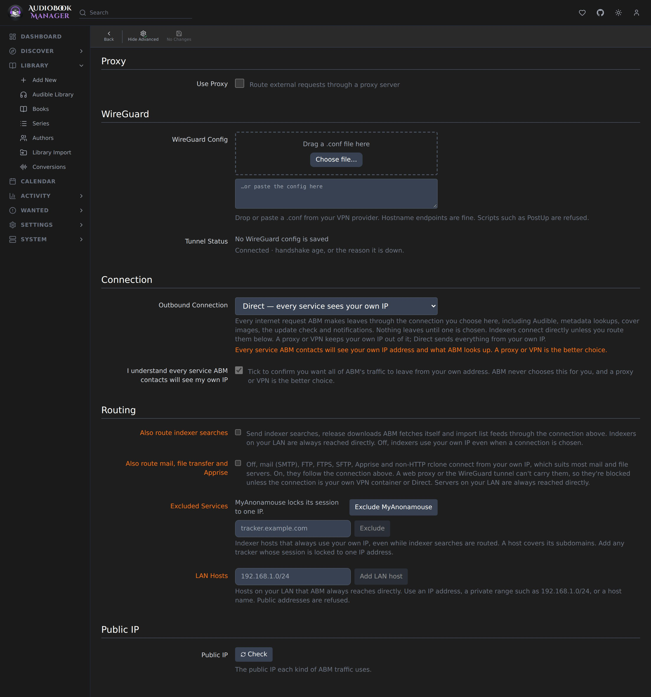

**Settings > Network** decides how ABM reaches the internet. Every outgoing request goes through the one connection you choose here, including Audible, metadata lookups, cover images, the update check and notifications. Nothing leaves until you choose one.

## Proxy

| Setting | Default | Effect |
|---|---|---|
| Use Proxy | off | Make the proxy below available as a connection |
| Proxy Type | HTTP | HTTP, HTTPS, SOCKS5 or SOCKS5 (remote DNS), which sends DNS lookups through the proxy too |
| Hostname, Port | empty | Proxy address |
| Username, Password | empty | Optional |
| Test Connection | | Test Proxy checks the proxy. It needs a hostname |

SOCKS4 is not supported. If a saved proxy still uses it, switch it to another type before saving. Testing and saving the proxy don't ask for your password.

## WireGuard

Paste a `.conf` from your VPN provider, or drop the file on the box. The server checks it before you save. A hostname endpoint is fine, and a hostname that resolves to several addresses (a pool) is tried one address after another if one stops answering. Scripts such as `PostUp` are refused.

Tunnel Status shows whether the tunnel is connected, how long ago its last handshake was, and which address of a pool is in use. Saved Config shows what was read from the config. The private key is never shown. Test checks the tunnel, Replace swaps the config, and Remove deletes the saved config and its encrypted keys after the usual confirmation. Remove is refused while the tunnel is the active connection. It doesn't ask for your password.

The Docker image includes wireproxy, which runs the tunnel without extra container privileges.

## Connection

**Outbound Connection** picks what ABM uses. Until you pick one it shows None chosen.

- **Use ABM's proxy** uses the proxy above.
- **WireGuard tunnel** uses the saved config. A config you've pasted can be chosen and saved in the same Save.
- **I route ABM through my own VPN/proxy container** is for when everything already leaves through a VPN or proxy container. ABM can't check this, so you tick an acknowledgement.
- **Direct** sends everything from your own IP, so every service ABM contacts sees it. You must tick an acknowledgement. A proxy or VPN is the better choice.

Audible sync is blocked until a connection is chosen.

## Routing

Routing is shown with **Show Advanced**.

| Setting | Default | Effect |
|---|---|---|
| Also route indexer searches | off | Send indexer searches, release downloads ABM fetches itself and import list feeds through the connection. Off, indexers use your own IP |
| Also route mail, file transfer and Apprise | off | Send mail (SMTP), FTP, FTPS, SFTP, Apprise and non-HTTP rclone through the connection. A web proxy or the WireGuard tunnel can't carry them, so they're blocked unless the connection is your own VPN container or Direct |
| Excluded Services | empty | Indexer hosts that always use your own IP, even while indexer searches are routed. A host covers its subdomains. Use it for a tracker that locks your session to one IP |
| LAN Hosts | empty | Hosts on your LAN that ABM always reaches directly: an IP address, a private range such as `192.168.1.0/24`, or a host name. Public addresses are refused |

An rclone remote ABM doesn't recognise is blocked rather than guessed at. A cover or metadata lookup blocked by these rules is retried once a connection allows it, and shows that it was blocked instead of looking missing.

## Public IP

Check shows the address the world sees for ABM and when it was last checked, so you can see the connection is really in use.

The on/off settings are checkboxes on desktop and switches on a phone.

## API

The Network settings are `GET` and `PUT /api/settings/network`. The proxy test is `POST /api/settings/network/proxy/test` and `DELETE /api/settings/network/wireguard` removes the config. None of them take `current_password`, the delete takes no body, and the request bodies refuse fields they don't know. The old `/api/settings/general/proxy*` and `/api/audible/diagnostics/public-ip` routes are gone. See the [API reference](/api-reference/).
