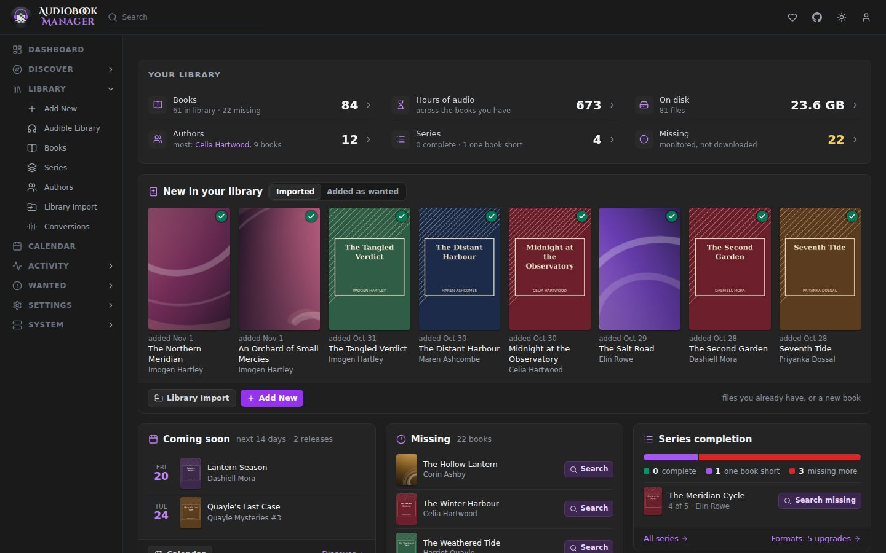

This is the shortest path from a running container to a book being searched for. Install ABM first: see [Install ABM](/en-au/installation/).

## 1. Sign in

The first visit opens the setup wizard, and its first step creates your login. Until you do, ABM refuses requests. The wizard also covers steps 2 to 4 below, and [First-run setup](/en-au/getting-started/first-run-setup/) describes each of its steps. How sign-in behaves afterwards is covered in [Security and sign-in](/en-au/settings/security/).

## 2. Choose how ABM reaches the internet

In the wizard this is the Network step. Later it is under **Settings > [Network](/en-au/settings/network/)**. Choose how ABM reaches the internet: a proxy, a WireGuard tunnel, your own VPN container or Direct. Nothing goes out until you choose one.

## 3. Add a root folder

A root folder is where ABM keeps books. Add it under **Settings > Media Management** in the **Root Folders** section. It should be the same folder your player (Audiobookshelf, for example) reads.

## 4. Add an indexer and a download client

- **Settings > Indexers**: Newznab, Torznab, MyAnonamouse, or Prowlarr. See [Indexers](/en-au/settings/indexers/).
- **Settings > Download Clients**: Deluge, qBittorrent, Transmission, rTorrent, SABnzbd, NZBGet or Blackhole. See [Download Clients](/en-au/settings/download-clients/).

If the client runs in another container, check that it and ABM see the downloads folder at the same path, or add a remote path mapping.

## 5. Set a quality profile

**Settings > Profiles** holds the quality ladder ABM uses to decide what to grab and what counts as an upgrade. A fresh install has none, so create one. The first profile you make becomes the default, and you can refine it later. See [Profiles](/en-au/settings/profiles/).

## 6. Connect Audible (optional)

If you have Audible books, connect your account under **Settings > Audible**. Pick your **Marketplace**, press **Connect Audible Account**, then **I Understand, Open Amazon Login**. Sign in to Amazon in the new tab. The blank or "Page not found" page you land on afterwards is expected. Copy the whole address from the address bar into **Redirect URL**, add a **Display Name** if you like and press **Complete Login**. Your password is never stored, and the first library sync starts straight away. See [Audible](/en-au/audible/).

## 7. Bring in or add books

- Already have a collection? Use [Library Import](/en-au/library-import/).
- Starting fresh? Use **Library > Add New** and search by title, author or series. See [Add New](/en-au/using/add-new/).

A book you add is wanted until a file for it is imported. Wanted books appear under **Wanted > Missing** and are searched automatically.

## 8. Watch it work

**Activity > Queue** shows what is downloading. **Activity > History** shows what was grabbed and imported. When something goes wrong, [Troubleshooting](/en-au/troubleshooting/) and the [Tasks](/en-au/system/tasks/) page are the places to look.

