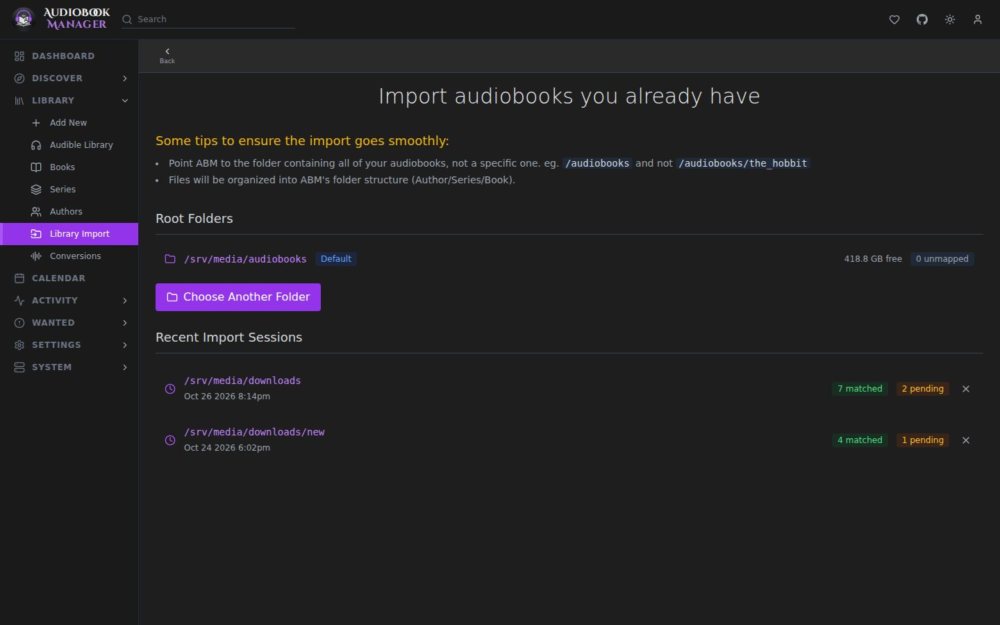
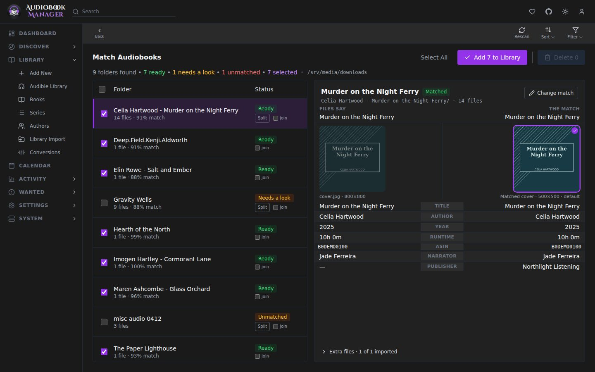

Library Import scans a folder of audiobooks, matches each folder to metadata, and adds the books to your library. **Library > Library Import** opens "Import audiobooks you already have", where you pick a folder to scan. Once the scan starts, ABM moves to the matching page, headed **Match Audiobooks**, where you check the matches and add the books.

## The flow

1. Scan a folder. Each folder with audio becomes a row.
2. Check the matches. Fix the ones that need it.
3. Tick the rows you want, then add them to the library or delete them.

Every option is an optional override of a default in Media Management.

## How a match is accepted

The scan accepts a match only when the files confirm it:

- the ASIN in the files' own tags finds the book, or
- the book's runtime is within three minutes of the files', and its series position or its title agrees with them.

An author or series position that contradicts the files rules a book out. A name the files give as the author that is the book's narrator or translator doesn't count against it, so a folder or tag that puts the reader or translator in the author's place still matches. When the files fit two different books or recordings equally well, neither is accepted.

The files' runtime counts only when every file of the book could be read. If one can't be measured, the row has no runtime: only its ASIN can confirm a match, and otherwise the book waits under **Needs a look**.

When a book is kept in two formats, each format is its own row and is measured on its own. A book split into parts in different formats is one row when it has a folder of its own, and its parts are added up.

Only an English edition, or one whose listing gives no language, is accepted on runtime. An edition in another language is accepted only when the files' own ASIN finds it. A book answered from [Local Storage](/en-au/settings/metadata/#local-storage) instead of a live lookup is never accepted without you.

When one of a row's lookups fails, only an ASIN match is accepted. A book found only by searching the author is offered only when its runtime fits the files', so a book with no listing reads **Unmatched** instead of suggesting another of the author's books.

Any other match is still offered as a suggestion, but the row counts under **Needs a look**, starts unticked, and **Select All** leaves it alone until you confirm that match or pick another. An accepted match for a book already in your library counts under **In library**. A **Needs a look** row whose suggestion is a library book asks its library question only once you confirm that match. Until then, ticking it blocks Add as a row that still needs a decision.

A book in several loose files that share a folder with other books, such as an author folder or the folder you scanned, is one row holding every part. Files that differ by a book or volume number stay separate rows. Parts are grouped per format, so a whole-book file beside them is a row of its own, and a bitrate in a file name, such as `128kbps`, is not a part number.

Two formats of one book, such as `Book.mp3` and `Book.m4b`, are one row per format, whether the files sit loose in the folder you scan or in a book folder of their own. Each row imports, removes and measures only its own file. A cover, cue or other non-audio file with the same name goes with the book's file when the book is there in one format, and stays where it is when it is there in two. This holds even when one copy is moved into the library and the other is cleared in the same import. Usually only the copy the book's quality profile ranks highest is offered for import, as described under [Copies in several formats](#copies-in-several-formats).

A tag written as `Title: Series, Book 2` is read as the title, the series and its position.

A series position written as a range, such as `1-3`, agrees with any position inside it. Two numbers written any other way, such as `1, 3`, count as no position.

A title, album, series, series part, artist, album artist, composer or narrator tag longer than 500 characters is ignored.

**Recent Import Sessions** on the Library Import page shows each scan with how many rows are matched, counting books already in the library, and how many are pending, counting rows still waiting for you to pick a match. Hidden copies are in neither count.

## Copies in several formats

When one folder holds the same book in several formats, with the same file names apart from the extension, the scan keeps one copy and puts the others under **Hidden**. The kept copy is the one the book's quality profile ranks highest. A book that isn't in your library yet uses the default quality profile. See [Profiles](/en-au/settings/profiles/#quality-profiles) for how the ladder ranks formats. A format switched off in the profile, or one that isn't on the ladder, ranks below every format switched on. With no quality profile at all, or when ABM can't read your quality profiles, formats rank in this order: M4B, M4A, MP3, FLAC, OGG, Opus, AAC, WMA.

When copies rank the same, one is still kept: the one with the higher bitrate, then the bigger one, then the one first in that order.

The ranking follows the profile as it is now, so changing the profile before you import changes which copy is kept.

Copies of one book can each match it. When a copy without a match of its own becomes the kept one, it takes the match of the best-ranked other copy that has one, so a matched copy is never hidden behind an unmatched one. This happens on a scan, on a profile change, when another copy is deleted or taken off the import, and on a rescan, including one that makes a copy already in the list the kept one. A copy that was deleted or taken off the import never gives its match, and a copy that is a library book's own folder keeps its own.

A hidden copy is never added. Its row says why, such as "MP3 copy of a book also here as M4B; this book's quality profile ranks M4B higher." Other reasons read "with no quality profile set, ABM prefers M4B", "ABM couldn't read your quality profiles, so its built-in order prefers M4B", "both rank the same and the M4B was picked as the better file", or "you chose to import the M4B".

Nothing is hidden, and every copy stays in the list, when:

- two of the copies are in the same format
- the copies' runtimes differ by more than three minutes or 2% of the longer one, whichever is more, since they may be different recordings

### Picking a copy

The folder details of a book kept in several formats have a **Formats** section listing each copy. **Import this one instead** on a hidden copy keeps that copy and hides the others behind it. When the copy you pick has no match of its own, it takes the match of the copy it replaced, so the match you were looking at stays with your pick. A copy that is a library book's own folder keeps its own. Your pick stays through a rescan, a change to the profile, and deleting another copy. Picking waits while a rescan or a delete runs.

### Rescan, delete and finishing

**Rescan** ranks a book's copies again when it finds a new one. A better format found on rescan hides the copy you already had, and the rescan's message says how many rows are now hidden.

Deleting the copy that was kept brings back the next best one. It takes the match of another copy still in the import, as above, or gets its lookup when none of them has a match and it hasn't had one.

When only hidden copies are left, All says so and offers a way to show them.

After Add, a "Delete the other copies?" dialog lists the hidden copies of the books just added, with each file it would delete. **Delete files** deletes them once you type `delete`. **Keep files** takes them off the import and leaves the files where they are. A session with hidden copies still in it stays open, and it closes on its own once every row left in it is imported.

## Reading the list

- The count bar above the list shows how many rows each status holds. Choosing a status there filters the list, the same as **Filter** in the header bar, and the two always show the same choice. All, Ready, Needs a look, Unmatched and In library are always there. The others show while they hold a row or are the chosen filter. The header bar has **Sort** (Folder name, Status, Title, Author, Series, Files) and **Filter** (All, Ready, Needs a look, No audio, Unmatched, In library, Lookup failed, Hidden, Needs a decision, Looking up, Deleted on add), and each filter shows its count. All leaves out hidden copies, and Hidden has its own count. A match you have confirmed is called Ready. Sort and filter are remembered on this device. They are not kept in the page address, so a link with `?sort=` or `?filter=` in it doesn't carry them over.
- Each row shows the cover, title, author and series, and how sure the match is as a percentage, such as "95% match". Each row keeps every match its title, author and series searches find. The folder details have **Find a match** or **Change match** to search by hand. The search lists Libex's best matches for what you typed first, then the books its title, author and series searches find, each book once, 50 at a time. More load as you scroll, or with **Load more**, until there are no more.
- When the files have no ASIN or runtime to confirm the edition, the folder details say so.
- **Rescan** picks up folders added since the scan and keeps your choices.
- A folder whose files lead into a system folder is left out of the scan results. A scan or a **Rescan** tells you how many folders it left out, and the scan's entry on System > Tasks gives the count too. A folder whose files link to another ordinary folder is still offered.

An ASIN found in a comment or description is only a hint. It counts as a match only when the title also agrees with the folder name. Only the dedicated ASIN tag counts on its own.

In an author tag, a name that carries a role after a dash or in parentheses, such as `Jay Brody - translator` or `Jane Doe (Narrator)`, is not added as an author, and `Jane Doe narrated by John Roe` adds only Jane Doe. An entry that lists several people with commas is kept as one name, without the role. The book's translator credits come from the metadata source once the book is matched, and other roles, such as illustrator or editor, are not kept.

A reader named in brackets in a folder or file name, such as `The Ashen Court (Read by Tobias Quill)` or `The Ashen Court [Narrated by Tobias Quill]`, is read as the narrator, and the bracket is left out of the title. A book folder named `Title by Author` keeps a "by" that belongs to the title, so `Bound by Salt by Maren Ashcombe` is the book Bound by Salt by Maren Ashcombe.

## Joining, splitting and adding

- Join rows that are one book split across folders. Join refuses a hidden copy ("Hidden copies can't be joined.") and a kept copy while other formats of it are still hidden, since those copies would be left behind. The joined row's match is only a suggestion: it counts under **Needs a look** and starts unticked until you confirm it or pick another. Its runtime is the parts' total only when every part has one, and it keeps an ASIN only when every part gives the same. Join is only for the parts of one book: leave two formats of one book as separate rows, since joining them adds both runtimes. Join and split wait while a rescan runs. A lookup that finishes after you join or split its row is only a suggestion too. Split them again from the folder details. A split asks first and says what happens: each file becomes a row of its own, whatever the folder matched to is discarded, and nothing on disk is touched.
- On a phone, hold a row for about half a second to start joining. A "Hold to join" hint shows until you dismiss it or open a row. Tap the other rows to mark them. They take numbers in the order you tap them, and the first one marked is the one the rest join into. **Join rows** in the more actions sheet does the same without holding. Join needs at least two marked rows, and nothing on disk is touched.
- On a phone, a folder's details have **Split into separate books** when the folder holds several files.
- A row's details offer **Confirm match** and **Delete**. A row with no audio only offers Delete. A hidden copy offers Delete and **Import this one instead**, as described under [Picking a copy](#picking-a-copy). A hidden copy can't be split, and neither can a kept copy while other formats of it are still hidden. Confirm match ticks a **Needs a look** row, and **Undo confirmation** takes back the tick along with it.
- Tick the folders you want, then choose what to do with them. The bar above the list has **Select All**, **Add to Library** and **Delete**, and the phone has Add and Delete too. The scan ticks the folders it is sure about for Add. **Select All** never ticks a hidden copy, except under the Hidden filter, where it ticks every hidden copy so you can delete them together.
- Add never imports a hidden copy, ticked or not. With only hidden copies ticked, Add is blocked with "Hidden copies are never added; delete them or untick them."
- Add is blocked with a reason shown above the button, such as "Select at least one folder" or "2 selected rows still need a decision". Add can't start while folders are being deleted. Add is also refused, with nothing touched, when two rows claim the same folder or file. Each row's folder and files are checked again when it is imported. A row whose folder or files lead into a system folder, through a link for example, fails with that reason and nothing is taken from it. A row whose folder or file, or any file joined into it, sits outside the folder the session scanned or leads out of it through a link fails with "Outside the folder this session scanned" and nothing is read, moved, copied, linked or deleted. Every row fails the same way if its import session no longer exists. ABM also checks each destination root folder again, once per import, and refuses to place files in a root that is missing, can't be read, isn't answering, or leads into a system folder. A slow network share gets up to 2 minutes to answer. One row that can't be read fails on its own, and the rest of the import carries on.
- Add is blocked when two ticked rows are matched to the same edition, and the reason names both: "A and B are matched to the same edition. Import one and delete or leave the other, or pick a different edition for one of them." One edition takes one folder.
- Anything that would remove or replace files asks first. Choosing a delete decision names the files and says whether they go to the recycle bin or are deleted for good, and the decision is only set once you confirm. That is a sheet on a phone and a dialog on desktop.
- A folder with **Include** turned off hides its decision, since nothing happens to it. On a phone, a folder that needs a decision opens with its question in view above the buttons.
- On a phone, Add opens a sheet showing what will be imported and what will be removed, with Copy, Move or Hardlink. Hardlink is greyed out with its reason underneath when it can't be used.
- Leaving the page saves your pending edits.

## Where books go

Books imported from a folder or drive outside every root folder are organized into the default root folder, and they send an On Import notification. Books that already sit inside a root folder and that ABM doesn't know yet are added where they are, and their files are renamed in place. A file loose at the top of a root folder, or sharing a folder with other books, is moved into its own book folder in that same root. Nothing is copied, and no notification is sent. An author folder holding one loose book beside other book folders brings in every book: the loose one is moved into its own folder. A book whose folder is an author folder and holds only its own loose files doesn't block the book folders beneath it, so downloads, Manual Import, Library Import, scans and Add Book all work for them. A root folder itself can't be picked as one book's source: ABM asks you to import the books inside it instead. Scans never notify. A joined row (several files put together as one book) counts as an import from outside when any of its files sits outside the root folder its folder is in: it is placed into the default root folder by the import mode and sends On Import. When a row adds missing files to a book already in the library, each file is handled on its own. A file that already sits inside one of your root folders is moved into the book's folder and renamed there, and is never copied, whatever the import mode. A file from outside your root folders follows the import mode (copy, move or hardlink). A row with both kinds is handled file by file. Adding files to an existing book sends no On Import notification. A book whose audio files can't be taken in fails the import with a message, and nothing is added for it.

The destination line on the page reads: "Books imported from outside your root folders are organized into this root folder and send an On Import notification. Adopting books already in a root folder renames their files in place and doesn't notify."

## Copy, move or hardlink

**Settings > Media Management > Importing** sets the default for Library Import of books from outside your root folders: copy (the default), move or hardlink. You can pick another for each import.

A hardlinked book takes no extra disk space and the original stays where it is. Hardlink needs the default root folder to support it and to be checked first. Otherwise the option is greyed out with the reason. A file that cannot be linked, such as one on another drive, is copied and never moved. The finished import says how many were copied.

## Extra files

**Import Extra Files** (on by default) brings a book's cover, notes and other non-audio files along. It applies to Library Import, Manual Import and completed downloads alike. With **Show Advanced**, **Preferred Cover** picks the matched Audible cover (the default) or the folder's own.

## Long values

A narrator, title or path cut off with an ellipsis opens in full when you tap or click it. Tap or click it again to close it. With a mouse, hovering shows the whole value too. From the keyboard, focus it and press Enter or Space.

## Deleting folders

Delete works on any scanned folder, with audio or without. It only takes the folders you ticked yourself, on screen, in this visit. The ticks the scan made for Add never count for Delete, and after a reload you tick again.

Delete asks first. The dialog lists what goes and says how many folders and how many files that is, since a row for a single file deletes that file and not its folder. You type `delete` to confirm, and the message afterwards counts folders and files the same way. Files go to the recycle bin when it is on, and the task log lists each path removed (the first 50 per row, then a count). A folder that can't be deleted is reported on its own row with the reason, and the others in the same batch are still deleted.

Delete refuses:

- the scanned folder itself, and anything outside the scan
- a folder that is, or holds, a root folder, the recycle bin or one of ABM's own folders, or that leads into a system folder
- a symlink
- a folder or file that is, sits inside, or contains a library book's folder or one of its files

It also refuses while any import is running, and an import can't start while folders are being deleted. A subfolder ABM can't read is never guessed at: the row fails, naming the folder, and nothing is removed. A row also fails if any of its files are still there afterwards. Deleting leaves every other book's folder alone. A row for a single file removes that file and the non-audio files that share its name exactly, so `Book.mp3` doesn't take `Book.part2.mp3` with it. When another format of the book shares its name, such as `Book.m4b`, the row removes only its own file. If any of those files belongs to a library book, nothing is removed. Deleting the copy of a book that kept other formats hidden brings back the next best one, as described under [Copies in several formats](#copies-in-several-formats).

A folder with no audio is deleted the same way as any other: tick it and choose Delete.

## Answers other than import

A row can also be answered **Delete these files, keep the library copy** to decline a copy of a book the library already has. It asks first with a "Delete these files?" dialog listing what goes, and has a Keep importing button to back out. Because this removes data, you type `delete` to confirm. The decision is only carried out when you Add, and it holds only for the library book it was about. Pick a match that asks something else, asks about a different library book, or asks nothing, and the earlier choice no longer applies, so the row asks again. Add refuses an import that would remove files to keep a library copy that is missing or has no files. The import checks again when it runs, and nothing is removed if the library copy has no files by then ("Your library has no copy of this book to keep") or if the folder holds files of a book in your library ("This folder holds files of a book in your library"). The row fails with that message. Rows that remove files instead of importing them run only after every import in the same Add has finished, and each is refused if any of its files belongs to a book in your library at that point. So they never remove files a book in that batch was just added from. Rows you keep or remove go through the same folder check as imported rows, so a folder that now leads into a system folder is never touched.

## Cover and extra files per folder

The inspector shows the folder's own cover beside the matched edition's, each with its pixel size. One click picks the other. Below it, **Extra files** lists every other file under the name of the Media Management setting it follows. A dot marks a choice that differs from the settings, and **Apply this cover and these file choices to the N other selected** copies one folder's choices to the rest. A row that adds files to a book already in the library has no picker.

See also [Moving a library in](/en-au/guides/moving-a-library-in/) and [Media Management](/en-au/settings/media-management/).
