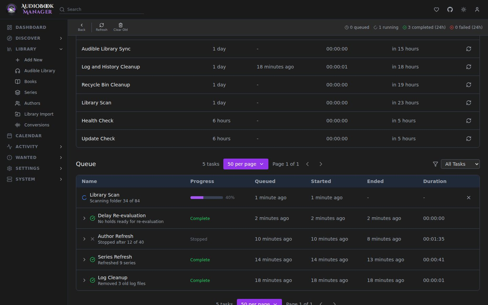

**System > Tasks** lists everything ABM does in the background: library scans, refreshes, imports, searches, downloads, syncs, backups. Each row shows its state (waiting, running, completed, failed, cancelled or stopped), progress, result and a log button. The log button shows only for a task that wrote a log. A few quick housekeeping tasks write none, so their rows have no log button. If the log file has since been deleted, opening it says the log no longer exists.

- A task that completed with entries in its error list shows as **Partial**. Expand it for each skipped item and the reason. A library scan skips a book whose folder is busy with a file transfer or another scan; those count toward books skipped. A library scan is **Failed** when any root folder you asked it to scan couldn't be scanned, or none is set up. A root folder a stop kept it from reaching doesn't count. Each such root is listed once with its reason, after the other roots have been scanned, and the scan sends its failure notification. Problems with individual books don't fail it; they show as **Partial** with the books listed.
- A task that finished with something skipped lists its warnings under its issues, so you can see what was skipped and why.
- A queued task has **Cancel**, and a running task that can be stopped has **Stop**, on desktop and on a phone. Both ask first. A cancelled task is taken out of the queue and never runs, and its details say "Cancelled before it started." If the task moves on before you answer, such as a queued task starting or a running one ending, the question is withdrawn and nothing is sent. Cancel never stops a task: if a queued task starts running before the cancel reaches it, ABM says it started first, the task keeps running, and its row offers **Stop** instead.
- Tasks that can be stopped include Library Import scans and imports, library scans, manual imports, bulk edits, book, author and series deletes, recycle bin moves and deletes, backups and their exports, Audible library syncs and bulk adds, metadata refreshes, Discover refreshes, cover caching, organizing books, batch searches, grab retries, delay re-checks, completed download checks, RSS syncs and conversions.
- A stopped task finishes the item it is working on, then stops before the next one. What it already did stays done. Until it reaches that point its row reads **Stopping…**. It then says how far it got, such as "Stopped after 3 of 10", and its details list the items done and not done. A task that reached its end before the stop took effect says so.
- A stopped library scan finishes the book it is on and skips the empty-folder and recycle bin cleanups. Its count is of book checks: each root folder checks every book, so with two root folders and 100 books, "Stopped after 150 of 200" means it got halfway through the second root folder. Folders Scanned includes the root folder it stopped in.
- A library scan's Books Updated counts each book whose files were added, updated or removed, or whose status changed.
- A stopped Organize finishes the book it is on and leaves the books it had not reached as they were. Its result says "Stopped. Books not reached were left as they were." and counts what it moved and renamed.
- A conversion is stopped at once: stopping its task cancels the job without finishing the book it is converting.
- A task that can't be stopped once it starts has no Stop and runs to its end. Examples are a single Audible download, a single book search, adding an author or a series, and the short housekeeping tasks.
- The queue filter has **Stopped** after **Failed**. Stopped holds the tasks you stopped and the ones you cancelled before they ran. Failed holds only tasks that failed.
- If a stop can't be delivered, ABM says so and the task keeps running. The same goes for a task that had nothing left to stop because it was already finishing on its own. Either way its row still has Stop, and you can stop it again.
- A stop asked for just before ABM restarts still holds: the task ends as stopped and does not run again.
- Shutting ABM down asks every running task that can be stopped to stop at its next safe point, and waits up to 30 seconds in all. A task that is safe to run again goes back in the queue. Any other is marked failed with "Interrupted by an application restart" and shows how far it got.
- A task with a retry coming stays as waiting until retries run out. The attempt number is shown.
- **Clear completed tasks older than 24 hours** tidies the list. Old tasks are also cleaned automatically (30 days by default).
- **Local Storage Backup** is the scheduled backup of [Local Storage](/en-au/settings/metadata/#storage-backups), with its log and a Run Now.
- Scheduled runs that did nothing appear here but not in the [Activity Log](/en-au/system/activity-log/).

## Gotchas

- Changing the recycle bin's folder can queue **Move Recycle Bin** or **Empty Old Recycle Bin**. Only one runs at a time, and a move that fails partway can be run again. See [Recycle Bin](/en-au/settings/media-management/#recycle-bin).
- Conversions are a separate queue. See [Conversions](/en-au/using/conversions/).
- The download sweeps (pending grab retry and completed download check) queue only while at least one download client is enabled, so the page does not fill with empty runs.
