The **Library** menu has three lists: **Books**, **Series** and **Authors**. **Add New** and **Library Import** put things in them. **Audible Library** and **Conversions** are covered on their own pages.

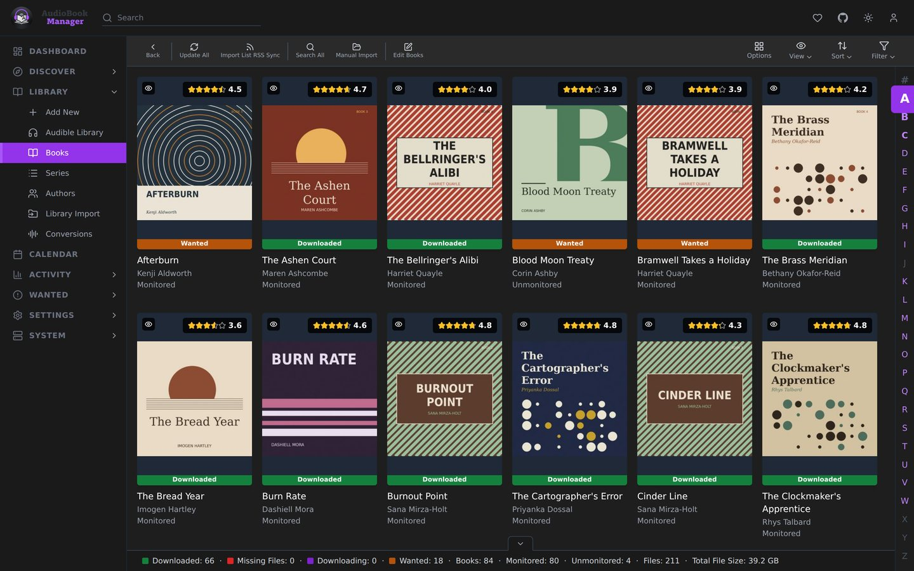

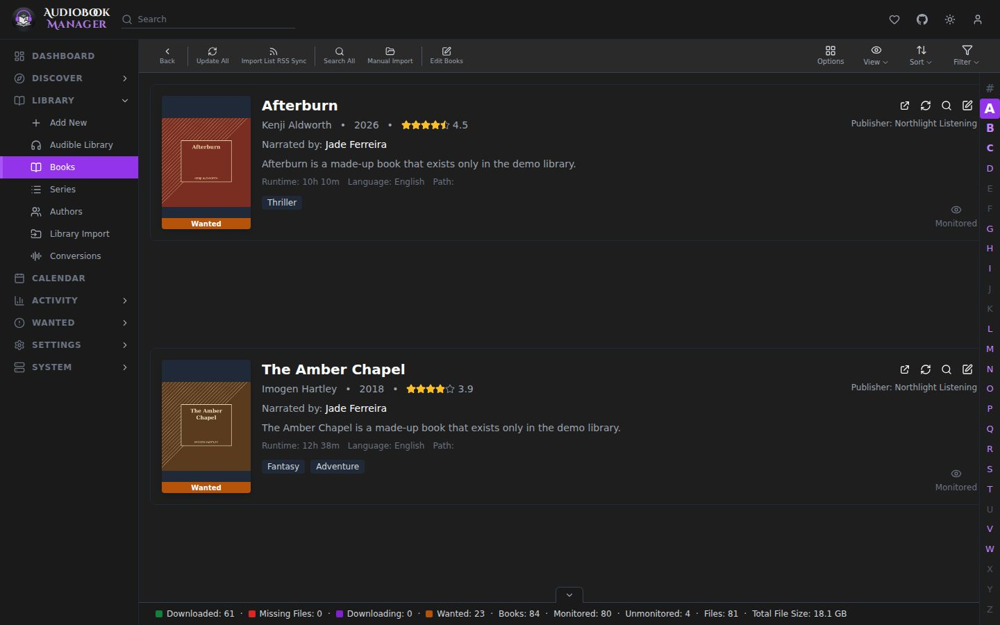

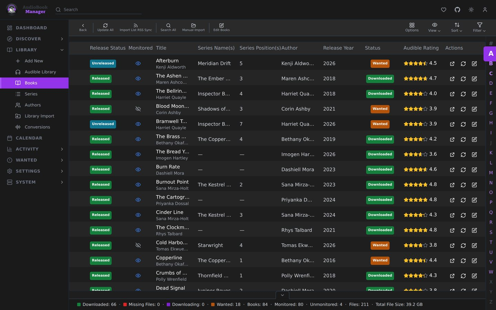

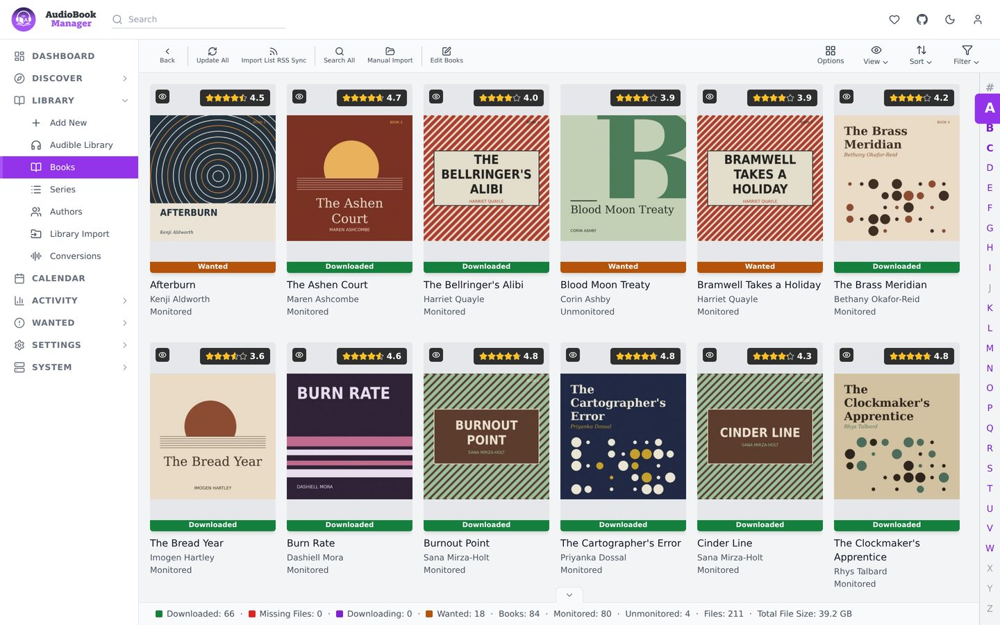

## Books

Each book is an overview row, a poster or a table line (the view switch is in the toolbar). A book has a status:

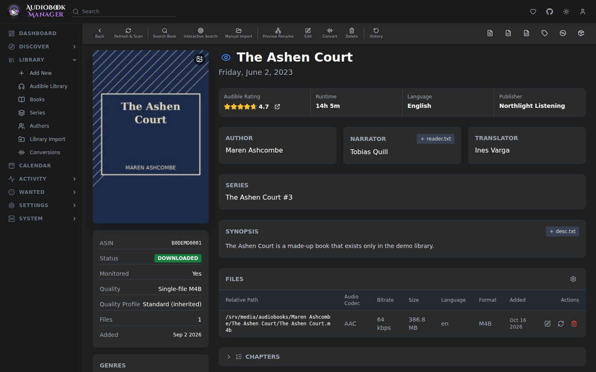

A book that has translators also shows them in a card after the narrators, on desktop and phone.

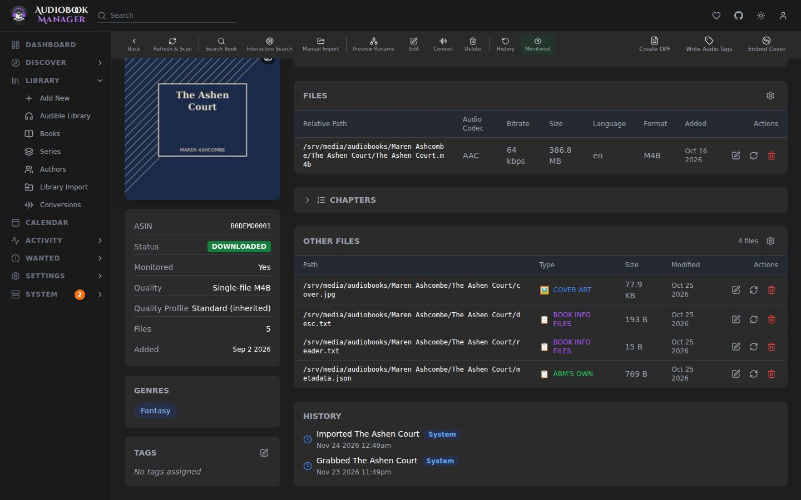

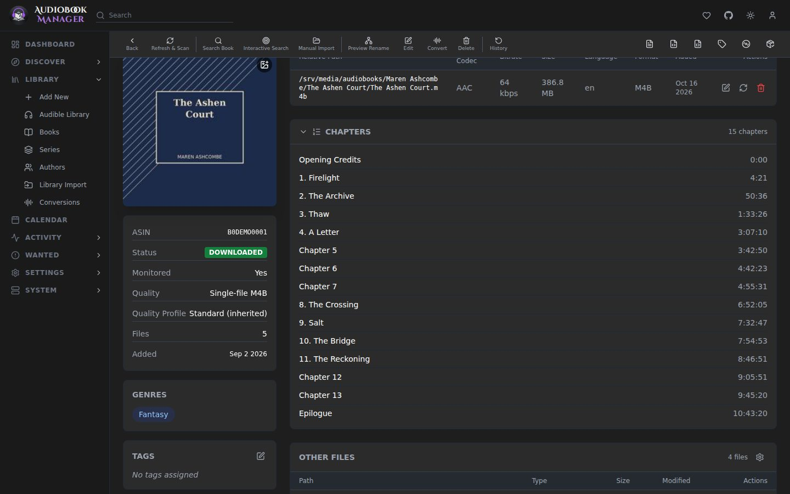

- **Wanted**: monitored, no files yet. ABM searches for it.
- **Downloaded**: files are on disk.
- **Missing Files**: the book was downloaded, but its files are no longer where ABM expects them.
- **Unmonitored**: ABM leaves it alone.

Open a book for its detail page: files, metadata, history, the quality ABM measured, and actions such as Refresh & Scan and the edit dialog (see below). See [Sidecar files](/en-au/using/sidecars/).

The detail page's toolbar can also write one thing at a time: **Create OPF**, **Create NFO**, **Create JSON** (`metadata.json`), **Write Audio Tags** and **Embed Cover**, or **Write All** for every one of them. On a phone these are in the Actions sheet under **Write to folder and files**: **Write All** at the top, then the book folder's files, each with the file name it writes, then the two audio file writes. A row for the cover, description or narrators only shows when the book has one. **Write All** writes the audio tags and the cover in one pass, so each audio file is rewritten once.

If you know Sonarr: a book is an episode, a series is a season-and-show in one, and an author is a way to group both. The difference is that one book can belong to several series, and ABM uses the primary one (the lowest position) when it needs to pick.

## Series

**Library > Series** lists every series as Posters or Overview. Each shows a bar such as `3/7 Books`, coloured Downloading, Continuing (everything released is downloaded and more is coming), Complete, Missing Books or Missing Books (Unmonitored). The filter offers All, Monitored Only, Unmonitored, Missing, Wanted, Complete, One Book Short and Incomplete. Complete, One Book Short and Incomplete list exactly the series that the footer's Complete and Missing Books counts add up to: One Book Short is a series with a single released book still missing, and Incomplete is every series with missing books. A series page shows the whole catalogue, including books you don't own. Filter it to All, In Library or Not in Library. **Add Remaining** or **Select to Add** brings the missing books in as wanted, and **Refresh Series** pulls the catalogue again. **Monitor New Books** (All or None, chosen in the Add New dialog) decides whether books that come out later are added as wanted. See [Series tracking](/en-au/using/series-tracking/).

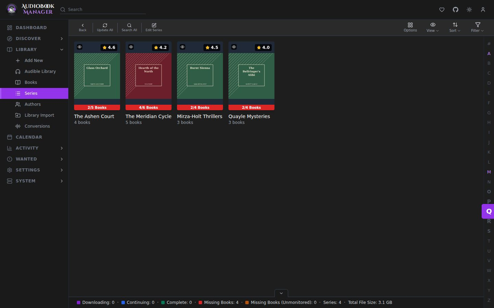

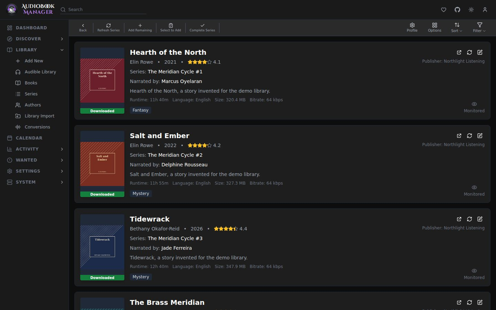

## Authors

**Library > Authors** lists authors as Posters or Overview, with the same progress colours as Series. The filter offers All, Has Books and No Books. An author page shows their catalogue grouped by series, with downloaded and total counts for each series, plus their quality profile, genres and rating. **Refresh Catalogue** pulls it again and **Search Author** searches for their wanted books. **Monitor New Books** works the same as for a series, and an author starts at None.

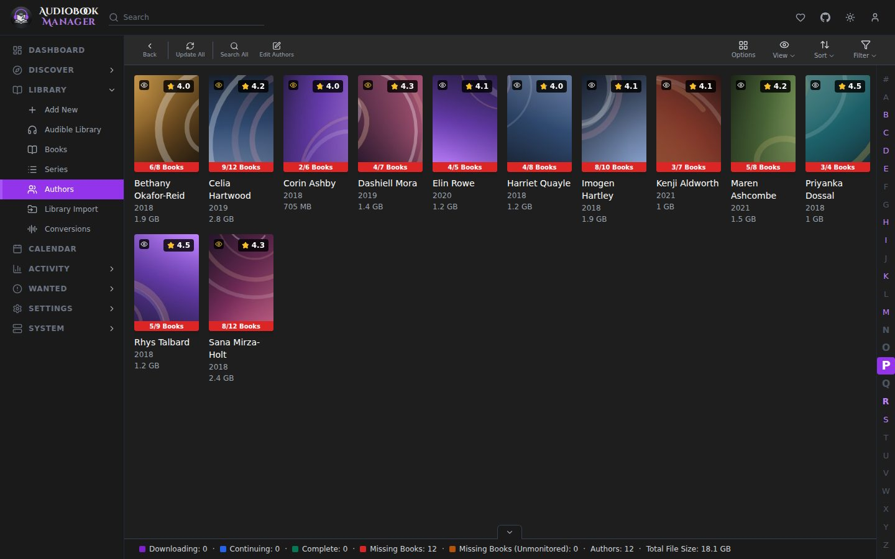

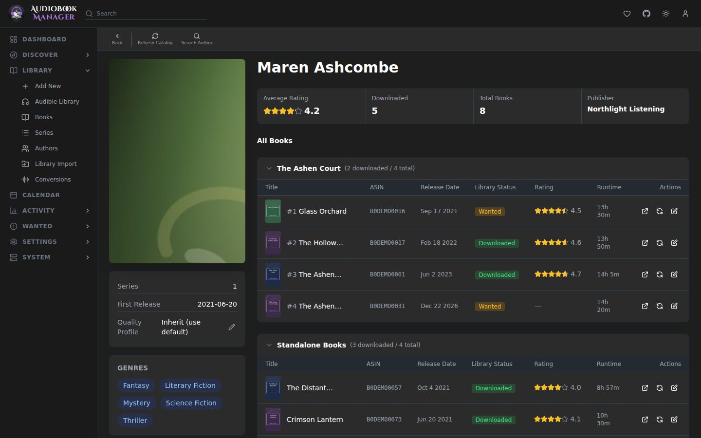

Deleting a series or author also deletes the books it has in the library. The dialog lists those books first, and flags any that are co-authored or also in another series. When there are books you type `delete` to confirm. Two boxes are off by default: one stops lists from adding these books again, and the other deletes the book folders and their contents from disk. Deleting them from disk is refused, with nothing changed, while the recycle bin is on but can't take the files. Afterwards ABM removes any other author or series left with no books, except ones you added yourself.

## Going back to a list

Going back from a book, series or author page puts **Books**, **Series**, **Authors** and **Audible Library** back where you left them, with the item you opened where it was. That works in every view and on a phone. Opening a list from the menu, or reloading it, starts at the top.

Ctrl+H and Ctrl+E jump to the top and bottom of the Books list in any view. Press `?` for every keyboard shortcut.

## Quality profile inheritance

A book's quality profile comes from, in order: its own override, its primary series, its primary author, then the default profile. See [Profiles](/en-au/settings/profiles/).

## The edit dialog

The edit dialog on a book changes ABM's own settings for it, not its metadata:

- **Monitored**
- **Quality Profile** (No Change when editing several)
- **Path**, for one book (with a button to recompute it), or **Root Folder** for a selection
- **Tags**
- **Write files**: one list of everything the save can write. **Write All** comes first and ticks every item, so one save writes every file Audiobookshelf reads. Then cover.jpg, desc.txt, reader.txt, an OPF, an NFO, metadata.json, **Write audio tags** and **Embed cover**, which writes the cover into the audio files. The OPF and NFO are named after the book's first audio file (for example `Dune.opf`), or after the book when there is no audio. Editing one book, the list names the exact `.opf` and `.nfo` it will write

The same dialog opens for series and authors and applies to each of their books. The write options run when you save. For each book the folder files are written first, then the audio tags. When **Embed cover** is ticked as well, the cover goes in with the tags in the same pass, so each audio file is rewritten once. A file the book has nothing to put in (no description, no narrator, no cover) is skipped, not treated as an error. For one book or a selection of books you see it as a warning when you save. For a series or an author it is skipped quietly. For a series or an author, the task's log lists each skipped or failed file write. Values are checked before anything is queued, so a bad one is refused at once instead of failing later. Each book is saved as it goes, so one book that fails doesn't undo the others, and audio tag errors are listed per book in the task's errors on the Tasks page.

## Tags

Books, authors and series can carry tags. Tags steer indexers, notifications, import lists and profiles, and filter the calendar feed. See [Tags](/en-au/settings/tags/).

## Custom filters

Library, Series, the Audible Library page and the Calendar let you build a custom filter from conditions. The value for Author, Narrator, Series, Publisher, Language, Genres, Tags, Keywords, Quality Profile, Format and Plans is one editable box with a list of every value already in your library. Typing narrows the list, picking an item sets it, and whatever you type is the value. Press Enter or leave the box to keep typed text even when it matches nothing. The search ignores accents, so `Brontë` also finds `Bronte`. On a phone, the sheet's search box works the same way, and tapping a row picks it.

Monitored, Released, Upgradable and Virtual Voice are Yes or No choices. Genres, Tags, Keywords and Plans match each value on its own. A saved value that contains a comma still matches the way it did before.

Discover's custom filters keep a plain text box, because its catalogue is filtered on the server.

## Selection

Select rows to act on several at once: monitor, search, tag, rename, delete. Deleting books shows the delete task's own progress and result, including how many it actually deleted, and refreshes the list in place. A delete that removes files, of one book or several, is refused with the reason before anything changes while the recycle bin is on but its folder doesn't exist, can't be written to or doesn't answer. See [Gotchas](/en-au/settings/media-management/#gotchas). Typing `delete` is only asked for deletes that remove files or data for good, such as a series or author with their books, a single file on disk, or the Workbench's delete-these-files choice. Removing a tag, profile, indexer or list entry is a plain confirm. A refused or failed delete or removal (Series, Authors, Blocklist, Queue, a Library Import session) shows the server's reason in a toast. With **Delete Book Folder** on, deleting a book removes its folder. When that folder holds anything of another book, only the book's own files and sidecars go and the rest stays. That covers another book's files or folder, audio not imported yet (loose beside it or in a folder beneath it), and another book's description, reader or metadata file. The same goes for a folder that is, or holds, a root folder, the recycle bin or ABM's own data, and that folder always stays. When the book's folder is a link, only the book's own files go, and the folder the link leads to keeps everything else. Organize previews every move and rename first; see [Book Naming](/en-au/settings/media-management/#book-naming). On a phone, see [Phone use](/en-au/phone/).
