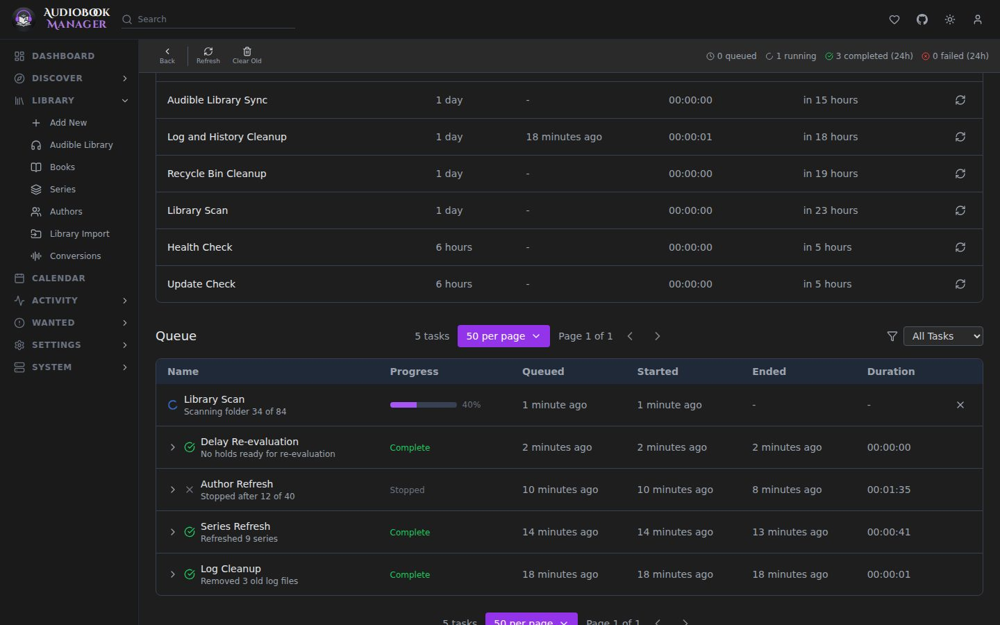

**System > Tasks** lists everything ABM does in the background: library scans, refreshes, imports, searches, downloads, syncs, backups. Each row shows its state (waiting, running, completed, failed), progress, result and a log button. The log button shows only for a task that wrote a log. A few quick housekeeping tasks write none, so their rows have no log button. If the log file has since been deleted, opening it says the log no longer exists.

- A task that completed with entries in its error list shows as **Partial**. Expand it for each skipped item and the reason. A library scan skips a book whose folder is busy with a file transfer or another scan; those count toward books skipped. A library scan is **Failed** when any root folder you asked it to scan couldn't be scanned, or none is set up. Each such root is listed once with its reason, after the other roots have been scanned, and the scan sends its failure notification. Problems with individual books don't fail it; they show as **Partial** with the books listed.
- A task that finished with something skipped lists its warnings under its issues, so you can see what was skipped and why.
- A task with a retry coming stays as waiting until retries run out. The attempt number is shown.
- **Clear completed tasks older than 24 hours** tidies the list. Old tasks are also cleaned automatically (30 days by default).
- **Local Storage Backup** is the scheduled backup of [Local Storage](/en-ca/settings/metadata/#storage-backups), with its log and a Run Now.
- Scheduled runs that did nothing appear here but not in the [Activity Log](/en-ca/system/activity-log/).

## Gotchas

- Changing the recycle bin's folder can queue **Move Recycle Bin** or **Empty Old Recycle Bin**. Only one runs at a time, and a move that fails partway can be run again. See [Recycle Bin](/en-ca/settings/media-management/#recycle-bin).
- Conversions are a separate queue. See [Conversions](/en-ca/using/conversions/).
- The download sweeps (pending grab retry and completed download check) queue only while at least one download client is enabled, so the page does not fill with empty runs.
