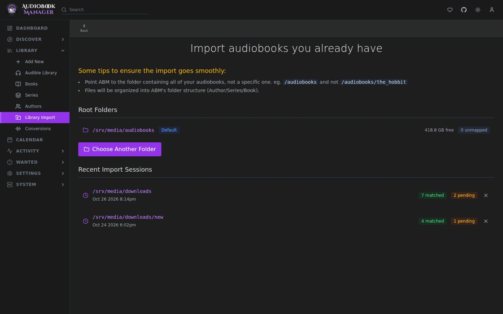
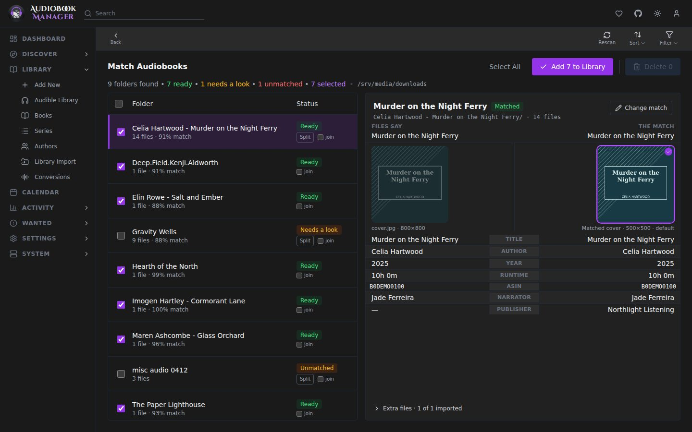

Library Import scans a folder of audiobooks, matches each folder to metadata, and adds the books to your library. **Library > Library Import** opens "Import audiobooks you already have", where you pick a folder to scan. Once the scan starts, ABM moves to the matching page, headed **Match Audiobooks**, where you check the matches and add the books.

## The flow

1. Scan a folder. Each folder with audio becomes a row.
2. Check the matches. Fix the ones that need it.
3. Tick the rows you want, then add them to the library or delete them.

Every option is an optional override of a default in Media Management.

## How a match is accepted

The scan accepts a match only when the files confirm it:

- the ASIN in the files' own tags finds the book, or
- the book's runtime is within three minutes of the files', and its series position or its title agrees with them.

An author or series position that contradicts the files rules a book out. When the files fit two different books or recordings equally well, neither is accepted.

The files' runtime counts only when every file of the book could be read. If one can't be measured, the row has no runtime: only its ASIN can confirm a match, and otherwise the book waits under **Needs a look**.

When a book is kept in two formats, each format is its own row and is measured on its own. A book split into parts in different formats is one row when it has a folder of its own, and its parts are added up. A completed download holding one book in two formats is measured as one copy, and has no runtime to match on when the copies' lengths differ by more than three minutes.

Only an English edition, or one whose listing gives no language, is accepted on runtime. An edition in another language is accepted only when the files' own ASIN finds it. A book answered from [Local Storage](/en-gb/settings/metadata/#local-storage) instead of a live lookup is never accepted without you.

When one of a row's lookups fails, only an ASIN match is accepted. A book found only by searching the author is offered only when its runtime fits the files', so a book with no listing reads **Unmatched** instead of suggesting another of the author's books.

Any other match is still offered as a suggestion, but the row counts under **Needs a look**, starts unticked, and **Select All** leaves it alone until you confirm that match or pick another. An accepted match for a book already in your library counts under **In library**. A **Needs a look** row whose suggestion is a library book asks its library question only once you confirm that match. Until then, ticking it blocks Add as a row that still needs a decision.

A book in several loose files that share a folder with other books, such as an author folder or the folder you scanned, is one row holding every part. Files that differ by a book or volume number stay separate rows. Parts are grouped per format, so a whole-book file beside them is a row of its own, and a bitrate in a file name, such as `128kbps`, is not a part number.

Two formats of one book, such as `Book.mp3` and `Book.m4b`, are separate rows, whether the files sit loose in the folder you scan or in a book folder of their own. Each row imports, removes and measures only its own file. A cover, cue or other non-audio file with the same name goes with the book's file when the book is there in one format, and stays where it is when it is there in two. This holds even when one copy is moved into the library and the other is cleared in the same import.

A tag written as `Title: Series, Book 2` is read as the title, the series and its position.

A series position written as a range, such as `1-3`, agrees with any position inside it. Two numbers written any other way, such as `1, 3`, count as no position.

A title, album, series, series part, artist, album artist, composer or narrator tag longer than 500 characters is ignored.

**Recent Import Sessions** on the Library Import page shows each scan with how many rows are matched, counting books already in the library, and how many are pending, counting rows still waiting for you to pick a match.

## Reading the list

- The summary line shows how many folders were found and how many are ready. The header bar has **Sort** (Folder name, Status, Title, Author, Series, Files) and **Filter** (Ready, Needs a look, No audio, Unmatched, In library, Lookup failed, Needs a decision, Looking up, Deleted on add). Each filter shows its count, and the counts match the summary line. A match you have confirmed is called Ready. Sort and filter are remembered on this device. They are not kept in the page address, so a link with `?sort=` or `?filter=` in it doesn't carry them over.
- Each row shows the cover, title, author and series, and how sure the match is as a percentage, such as "95% match". The folder details have **Find a match** or **Change match** to search by hand.
- When the files have no ASIN or runtime to confirm the edition, the folder details say so.
- **Rescan** picks up folders added since the scan and keeps your choices.

An ASIN found in a comment or description is only a hint. It counts as a match only when the title also agrees with the folder name. Only the dedicated ASIN tag counts on its own.

## Joining, splitting and adding

- Join rows that are one book split across folders. The joined row's match is only a suggestion: it counts under **Needs a look** and starts unticked until you confirm it or pick another. Its runtime is the parts' total only when every part has one, and it keeps an ASIN only when every part gives the same. A book joined from two formats with the same file names counts once, taking the longer format's runtime, or none when they differ by more than three minutes or one of the joined rows already holds both formats. A lookup that finishes after you join or split its row is only a suggestion too. Split them again from the folder details. A split asks first and says what happens: each file becomes a row of its own, whatever the folder matched to is discarded, and nothing on disk is touched.
- On a phone, hold a row for about half a second to start joining. A "Hold to join" hint shows until you dismiss it or open a row. Tap the other rows to mark them. They take numbers in the order you tap them, and the first one marked is the one the rest join into. **Join rows** in the more actions sheet does the same without holding. Join needs at least two marked rows, and nothing on disk is touched.
- On a phone, a folder's details have **Split into separate books** when the folder holds several files.
- A row's details offer **Confirm match** and **Delete**. A row with no audio only offers Delete. Confirm match ticks a **Needs a look** row, and **Undo confirmation** takes back the tick along with it.
- Tick the folders you want, then choose what to do with them. The bar above the list has **Select All**, **Add to Library** and **Delete**, and the phone has Add and Delete too. The scan ticks the folders it is sure about for Add.
- Add is blocked with a reason shown above the button, such as "Select at least one folder" or "2 selected rows still need a decision". Add can't start while folders are being deleted. Add is also refused, with nothing touched, when two rows claim the same folder or file.
- Anything that would remove or replace files asks first. Choosing a delete decision names the files and says whether they go to the recycle bin or are deleted for good, and the decision is only set once you confirm. That is a sheet on a phone and a dialog on desktop.
- A folder with **Include** turned off hides its decision, since nothing happens to it. On a phone, a folder that needs a decision opens with its question in view above the buttons.
- On a phone, Add opens a sheet showing what will be imported and what will be removed, with Copy, Move or Hardlink. Hardlink is greyed out with its reason underneath when it can't be used.
- Leaving the page saves your pending edits.

## Copy, move or hardlink

**Settings > Media Management > Importing** sets the default for Library Import: copy (the default), move or hardlink. You can pick another for each import.

A hardlinked book takes no extra disk space and the original stays where it is. Hardlink needs the default root folder to support it and to be checked first. Otherwise the option is greyed out with the reason. A file that cannot be linked, such as one on another drive, is copied and never moved. The finished import says how many were copied.

## Extra files

**Import Extra Files** (on by default) brings a book's cover, notes and other non-audio files along. It applies to Library Import, Manual Import and completed downloads alike. With **Show Advanced**, **Preferred Cover** picks the matched Audible cover (the default) or the folder's own.

## Long values

A narrator, title or path cut off with an ellipsis opens in full when you tap or click it. Tap or click it again to close it. With a mouse, hovering shows the whole value too. From the keyboard, focus it and press Enter or Space.

## Deleting folders

Delete works on any scanned folder, with audio or without. It only takes the folders you ticked yourself, on screen, in this visit. The ticks the scan made for Add never count for Delete, and after a reload you tick again.

Delete asks first. The dialog lists the folders and how many audio files each holds, and you type `delete` to confirm. Files go to the recycle bin when it is on, and the task log lists each path removed (the first 50 per row, then a count). A folder that can't be deleted is reported on its own row with the reason, and the others in the same batch are still deleted.

Delete refuses:

- the scanned folder itself, and anything outside the scan
- a root folder or a protected folder
- a symlink
- a folder or file that is, sits inside, or contains a library book's folder or one of its files

It also refuses while any import is running, and an import can't start while folders are being deleted. A subfolder ABM can't read is never guessed at: the row fails, naming the folder, and nothing is removed. A row also fails if any of its files are still there afterwards. Deleting leaves every other book's folder alone. A row for a single file removes that file and the non-audio files that share its name exactly, so `Book.mp3` doesn't take `Book.part2.mp3` with it. When another format of the book shares its name, such as `Book.m4b`, the row removes only its own file. If any of those files belongs to a library book, nothing is removed.

A folder with no audio is deleted the same way as any other: tick it and choose Delete.

## Answers other than import

A row can also be answered **Delete these files, keep the library copy** to decline a copy of a book the library already has. It asks first with a "Delete these files?" dialog listing what goes, and has a Keep importing button to back out. Because this removes data, you type `delete` to confirm. The decision is only carried out when you Add, and it holds only for the library book it was about. Pick a match that asks something else, asks about a different library book, or asks nothing, and the earlier choice no longer applies, so the row asks again. Add refuses an import that would remove files to keep a library copy that is missing or has no files. The import checks again when it runs, and nothing is removed if the library copy has no files by then ("Your library has no copy of this book to keep") or if the folder holds files of a book in your library ("This folder holds files of a book in your library"). The row fails with that message. Rows that remove files instead of importing them run only after every import in the same Add has finished, and each is refused if any of its files belongs to a book in your library at that point. So they never remove files a book in that batch was just added from.

## Cover and extra files per folder

The inspector shows the folder's own cover beside the matched edition's, each with its pixel size. One click picks the other. Below it, **Extra files** lists every other file under the name of the Media Management setting it follows. A dot marks a choice that differs from the settings, and **Apply this cover and these file choices to the N other selected** copies one folder's choices to the rest. A row that adds files to a book already in the library has no picker.

See also [Moving a library in](/en-gb/guides/moving-a-library-in/) and [Media Management](/en-gb/settings/media-management/).
