Below 768px wide ABM uses phone layouts. From 768px to 1023px the sidebar shrinks to icons, and from 1024px up you get the full sidebar.

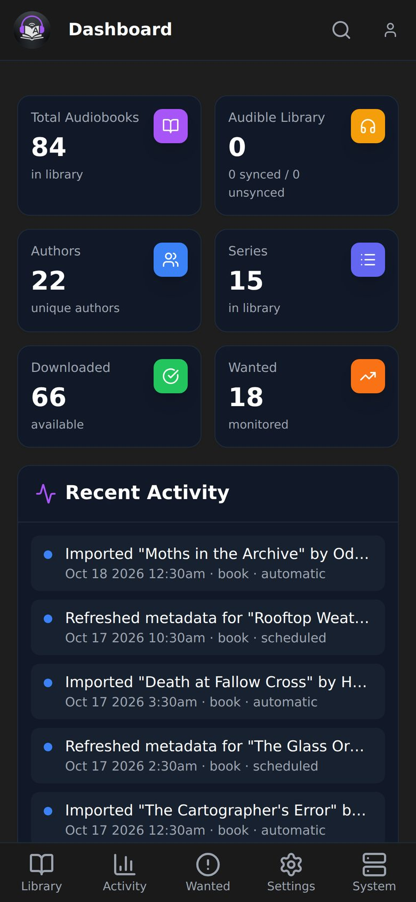
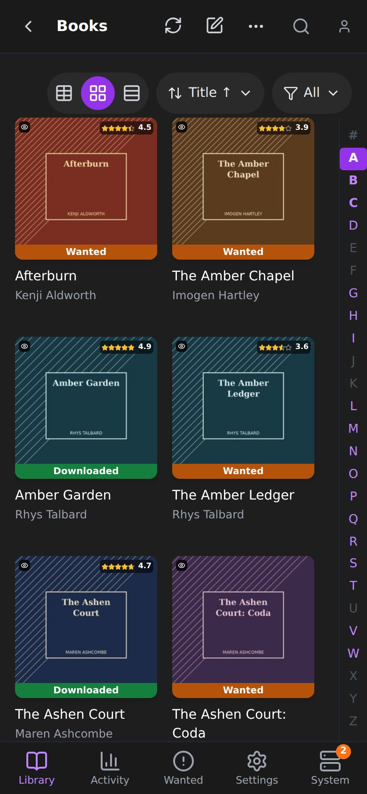
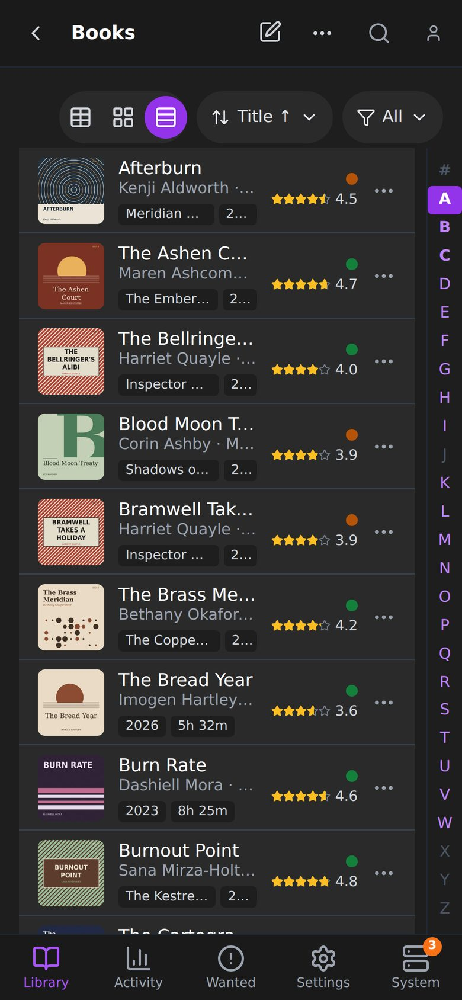

## Navigation

There is no sidebar. A bar at the bottom has five tabs: Library, Activity, Wanted, Settings and System. A tab with several pages opens a small menu above it. Library holds Books, Authors, Series, Add New, Library Import, Audible Library, Conversions and the Discover pages. Activity holds Queue, History, Calendar and Blocklist. Tap the logo for the Dashboard.

## The top bar

Page actions are icons. Those that don't fit are under **More actions**, which opens a sheet. On Indexers, Download Clients, Import Lists, Connect, Profiles and Tags, Add is the plus button in the top bar. A settings page's Save becomes a bar pinned to the bottom of the screen.

Pull down at the top of a page to refresh it.

## Lists

- A strip under the header holds Sort, Filter and the view switch. The Filter turns purple while one is active, and saved and custom filters are inside its menu. Paged lists such as Queue, History and Discover also have rows per page.
- Books offers Table, Posters and Overview. Series and Authors offer Posters and Overview. In Table and Overview each book is one row: cover, title, authors and narrators, a few chips, a status dot and the rating.
- Poster size sets the columns: small is 3, medium is 2, large is 1.
- Tap a row to open it. Everything else is behind the **...** button, which opens an actions sheet.
- The A to Z bar stays on the right. It hides when the screen is very short, such as a phone held sideways.
- Totals and the status legend sit at the end of the list.
- Tables such as Queue and History show each row as a card.

## Import Workbench

- On Library Import's results page, the title is Match Audiobooks. It gets smaller below 390 pixels wide and wraps to two lines below 360, so it shows in full.
- The **...** sheet has three groups. Selection holds Select all ready, Deselect unmatched and Join rows. Sort holds the sort choices. Scan holds Rescan for new folders.
- The bar at the bottom keeps only the count of selected folders, Deselect all and Add. Joining is covered under Joining, splitting and adding in Library Import.

## Selection

In selection mode, tapping a row selects it. The selection bar replaces the bottom tabs, and Back leaves selection mode.

## Book, series and author pages

A book page has Search, Interactive, Import (Convert once it has files) and Refresh at the top, with Edit and an Actions sheet next to them, and Overview, Files, Chapters and History tabs below. On a series page, tapping a book you don't own opens its actions.

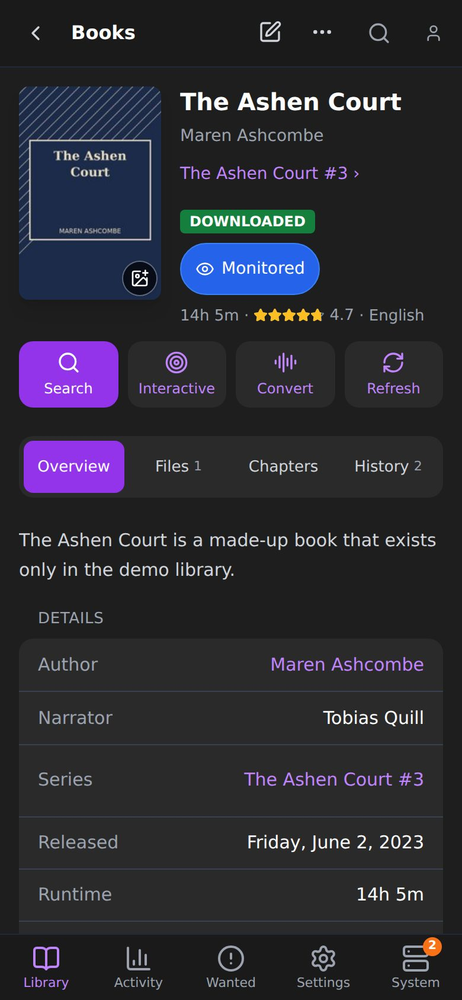
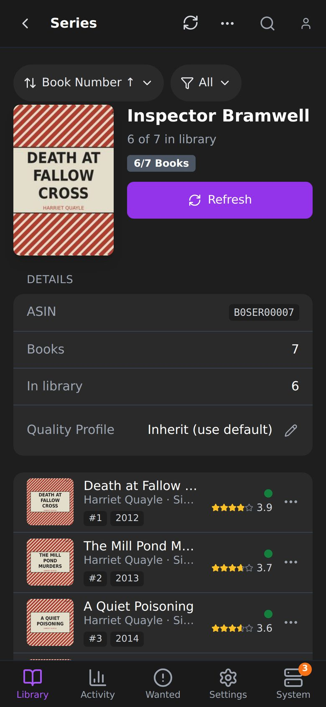
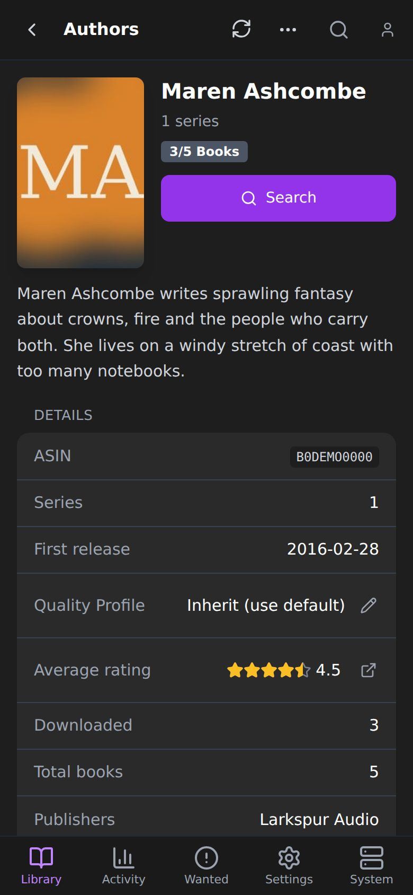

## Other pages

- Calendar is a day-by-day list. The view picker sets the period. Agenda is not offered.
- Conversions has Queue and History tabs.
- Dashboard cards stack in one column.
- Dialogs open as sheets from the bottom of the screen.

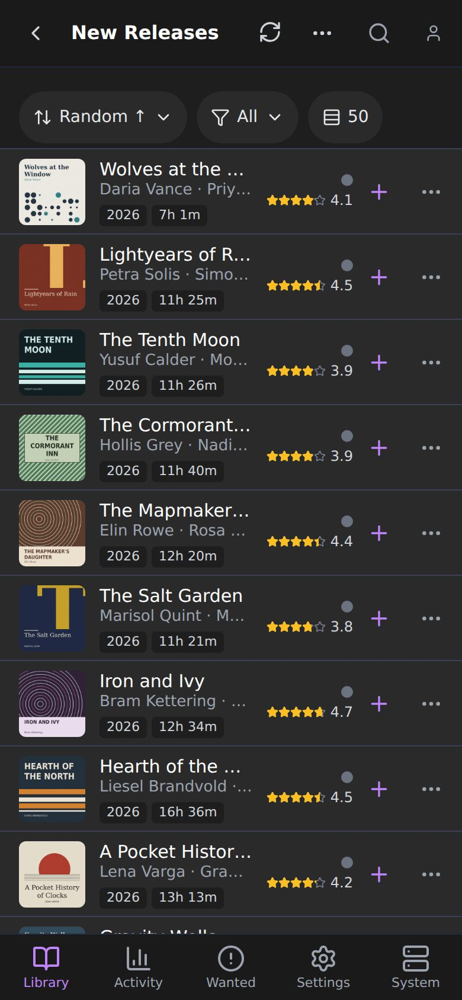
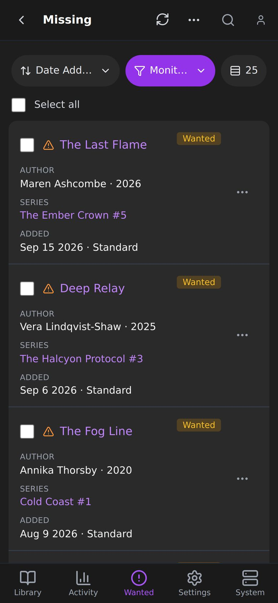
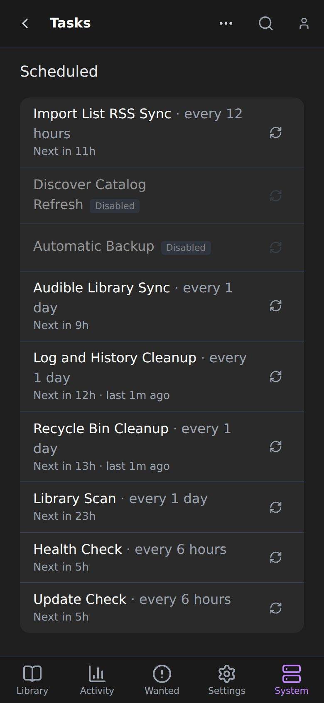

## Settings

Settings is a grouped list: Library, Sources and App. Each row is a link with the page's name and what it is for. Download clients, indexers and other entries are full-width cards.

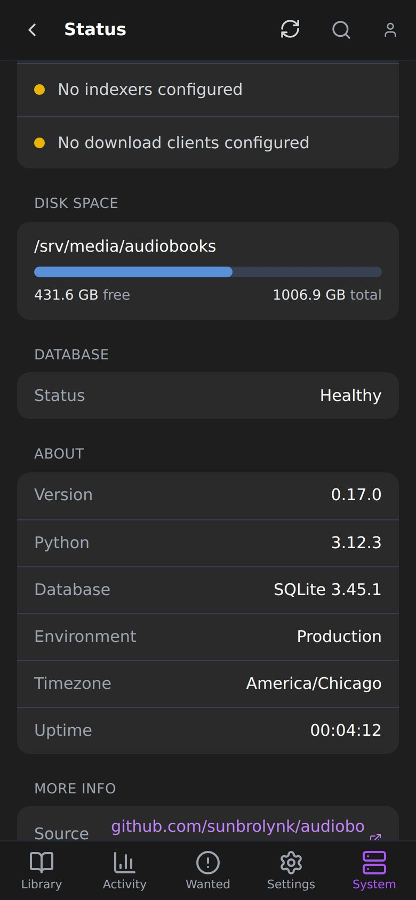
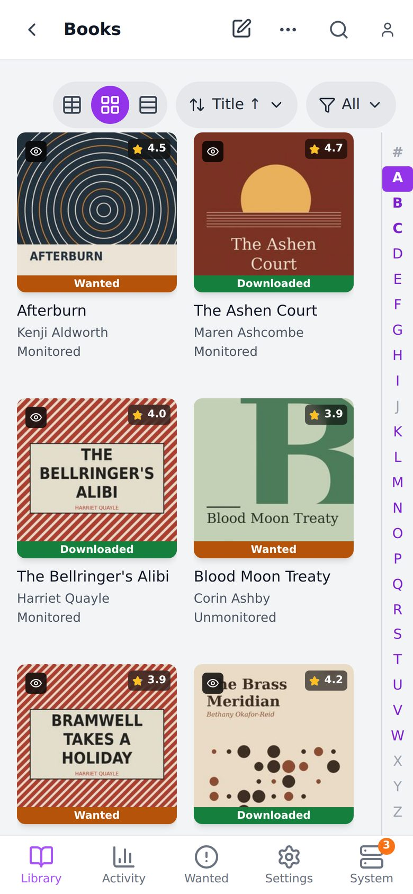

## Import Workbench

:::caution[Coming in the next release]
The phone layout of the Import Workbench is not in a released version yet.
:::

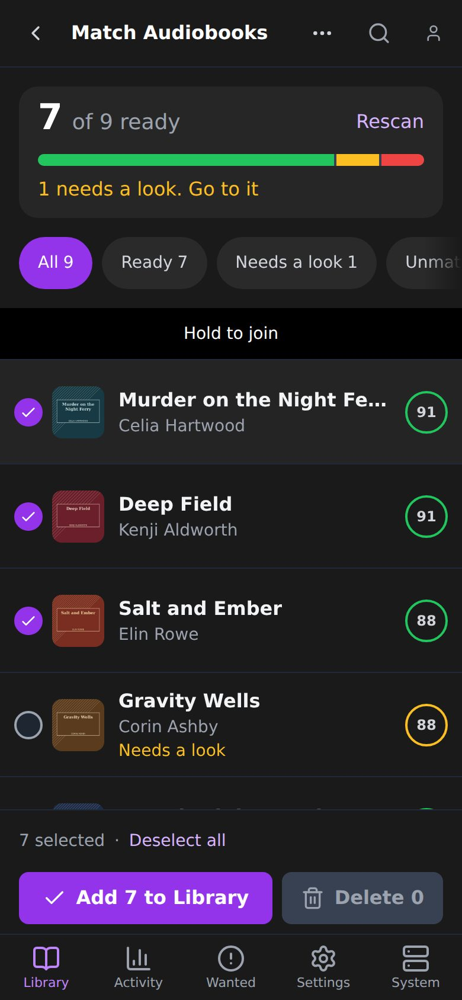

- A summary card shows how many folders are ready. Tap it to open the legend and filter the list.
- The bottom bar shows how many are selected and the Add button, and says why Add is blocked.
