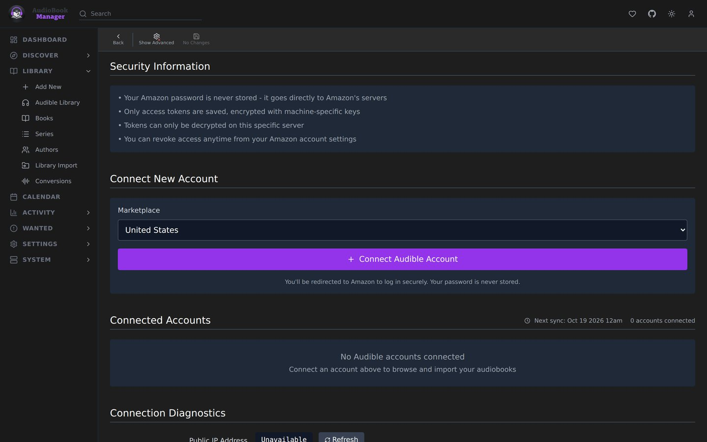

**Settings > Audible** is where accounts connect and syncing and downloading are tuned. How the feature works is on the [Audible](/audible/) page.

## Overview

The page opens with a short Overview. Each sync adds and downloads your Audible books as set by Mirror Audible library to ABM. You sign in on Amazon's own page, so ABM never sees your password. Tokens are encrypted with this install's secret key (`APP_SECRET`, or the key file ABM generates), so keep it and the database private. To sign ABM out, deregister it from your Amazon account.

## Accounts

Connecting an account takes a **Marketplace**, a **Display Name** and the **Redirect URL** that Amazon sends back after you sign in. Each account keeps its own library. Under **Connected Accounts**, every account has an **Enabled** switch and a **Sync now** button. Turning Enabled off pauses the account without signing it out, and it shows as Disabled. Sync now syncs only that account and is greyed out while the account is disabled or a sync is running. A failed save, sign-in step or sync shows the reason in a toast. If an account needs to sign in again, sign in on the same account instead of deleting it. Deleting drops its library and removes its device from Audible.

## Schedule

| Setting | Effect |
|---|---|
| Auto Sync | Sync the library on a schedule |
| Sync on Account Add | Sync as soon as an account is connected |
| Frequency | Daily, weekly or monthly. Weekly adds Day of Week. Monthly adds Day of Month (1-28). Day of Week must be 0 to 6, counting from Sunday, and the job fires on the day you pick. A value outside either range is refused with HTTP 422. A numeric weekday in a cron expression works as in standard cron, so `0 3 * * 0` is Sunday. |
| Time | Hour and minute |
| Use CRON Expression | A custom cron expression replaces the options above. One ABM cannot parse is refused with HTTP 400 and nothing is saved. With Auto Sync off the schedule is not checked |

## Download Settings

| Setting | Default | Effect |
|---|---|---|
| Mirror Audible library to ABM | on | Each sync adds the Audible books that aren't in ABM yet and downloads the ones without files, up to 25 per sync. Turning it on shows how many books the next sync will add and download. See [Mirror Audible library to ABM](/audible/#mirror-audible-library-to-abm) |
| Concurrent Downloads | 2 | 1 to 5. Higher is faster and can hit Audible's rate limits. |
| Preferred Quality | High | High or Normal. This is the quality ABM asks Audible for on every download |
| Delete Encrypted Files | on | Remove the encrypted AAXC file after it is decrypted to M4B |
| Temp Download Path | empty | Empty uses the system temp folder. Shown when advanced settings are on |

Download failures are retried by themselves a few times, with a delay that widens, and an outage that outlasts that re-queues the task for up to six hours. A license denial, an unowned book or a decryption failure fails once.

## Connection Diagnostics

Pick an account and run diagnostics. It tests FFmpeg, credentials, the API connection and download capability, and shows your outgoing IP as Audible sees it.
