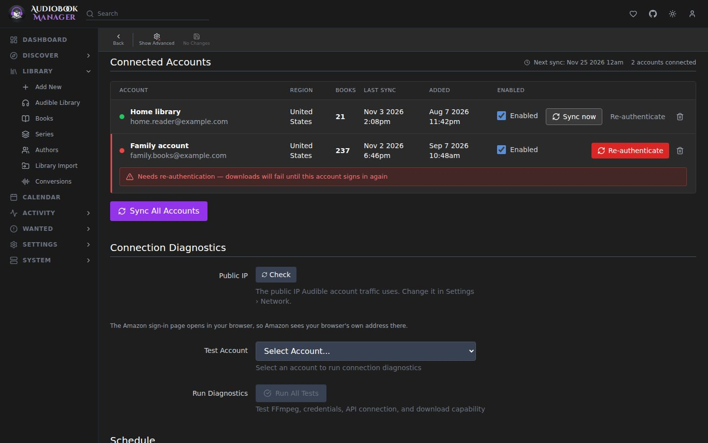

**Settings > Audible** is where accounts connect and syncing and downloading are tuned. How the feature works is on the [Audible](/audible/) page.

## Overview

The page opens with a short Overview. Each sync adds and downloads your Audible books as set by Mirror Audible library to ABM. You sign in on Amazon's own page, so ABM never sees your password. Tokens are encrypted with this install's secret key (`APP_SECRET`, or the key file ABM generates), so keep it and the database private. To sign ABM out, deregister it from your Amazon account.

## Accounts

Connecting an account takes a **Marketplace**, a **Display Name** and the **Redirect URL** that Amazon sends back after you sign in. Each account keeps its own library. The redirect URL is checked strictly: https, the exact sign-in host, no port, no username or password. See [Signing in](/audible/#signing-in). A failed save, sign-in step or sync shows the reason in a toast. If an account needs to sign in again, sign in on the same account instead of deleting it. Signing in again keeps its Audible library, its downloaded and imported books and their links. Deleting removes its Audible library from ABM until a later sync rebuilds it, and removes its device from Audible.

Connected accounts are listed in one table with a column each for the account name and email, region, book count, last sync, date added and an **Enabled** checkbox. Turning Enabled off pauses the account without signing it out, and it shows as Disabled. Each row has **Sync now**, which syncs only that account and is unavailable while the account is disabled or a sync is running, and a button to disconnect the account that asks you to confirm first. Every account also has **Re-authenticate**, which signs the account in again and registers it afresh. An account that needs it shows a warning with the reason: its credentials were rejected, it needs to sign in again, or it still uses the old device registration that Audible refuses download licences to. An account whose credentials need signing in again has Re-authenticate in place of Sync now. On a phone each account is its own card with a status dot, a Books, Synced and Region strip, Sync now, **Sign in again** and a trash button that asks you to confirm before disconnecting. Enabled is a switch, and an account that needs to sign in again shows the warning with Sign in again inside it.

## Schedule

| Setting | Effect |
|---|---|
| Auto Sync | Sync the library on a schedule |
| Sync on Account Add | Sync as soon as an account is connected |
| Frequency | Daily, weekly or monthly. Weekly adds Day of Week. Monthly adds Day of Month (1-28). Day of Week must be 0 to 6, counting from Sunday, and the job fires on the day you pick. A value outside either range is refused with HTTP 422. A numeric weekday in a cron expression works as in standard cron, so `0 3 * * 0` is Sunday. |
| Time | Hour and minute |
| Use CRON Expression | A custom cron expression replaces the options above. One ABM cannot parse is refused with HTTP 400 and nothing is saved. With Auto Sync off the schedule is not checked |

## Download Settings

| Setting | Default | Effect |
|---|---|---|
| Mirror Audible library to ABM | on | Each sync adds the Audible books that aren't in ABM yet and downloads the ones without files, up to 25 per sync. Turning it on shows how many books the next sync will add and download. See [Mirror Audible library to ABM](/audible/#mirror-audible-library-to-abm) |
| Concurrent Downloads | 2 | 1 to 5. This is how many audio downloads run at once. Licence requests still go one at a time per account, with a short pause between them. When Audible throttles an up-to-date account's download licences, ABM stops asking for that account for 48 hours, and signing the account in again lifts the hold. An account on the old device registration isn't held: it has to sign in again. |
| Preferred Quality | High | High or Normal. This is the quality ABM asks Audible for on every download |
| Delete Encrypted Files | on | Remove the encrypted AAXC file after it is decrypted to M4B |
| Temp Download Path | empty | Empty uses the system temp folder. Shown when advanced settings are on |

Download failures are retried by themselves a few times, with a delay that widens, and an outage that outlasts that re-queues the task for up to six hours. A license denial, an unowned book or a decryption failure fails once. A throttled licence also fails once. On an account still on the old device registration, the error says to sign in to the account again on Settings > Audible, since waiting doesn't fix it, and ABM doesn't hold the account. On an up-to-date account, the error says to try again later and starts the 48-hour hold. Either way, the account's other downloads waiting for a licence then fail straight away, and nothing more is sent to Audible, until the account signs in again or the hold ends.

## Connection Diagnostics

Pick an account and run diagnostics. It tests FFmpeg, credentials, the API connection and download capability, and shows your outgoing IP as Audible sees it (the same Public IP check as on [Network](/settings/network/)). For an account on a throttle hold, or one Audible has already refused on its old device registration, the download capability test reports it and sends nothing to Audible.
