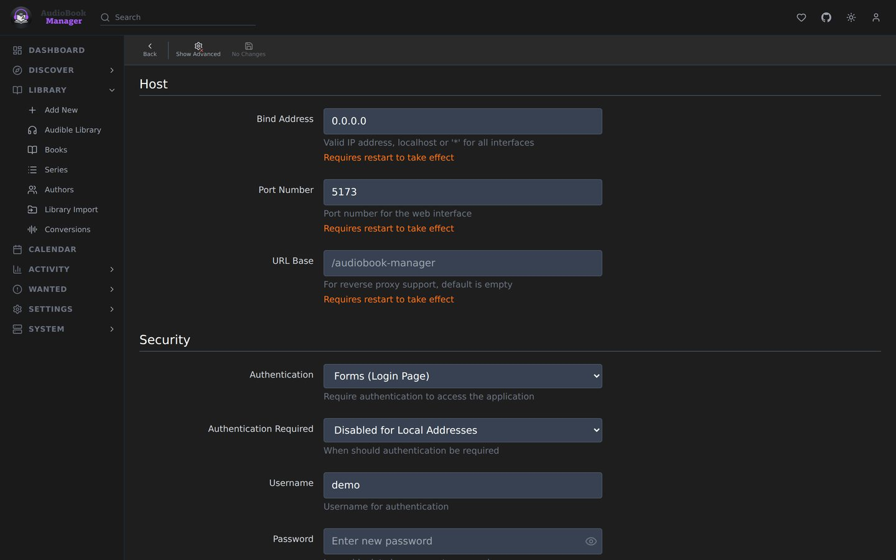

**Settings > General** has sections for Host, Proxy & VPN, Security, Logging and Backups. Security has [its own page](/settings/security/).

## Host

| Setting | Default | Effect |
|---|---|---|
| Bind Address | `*` | Address to listen on. Needs a restart |
| Port Number | 5173 | Needs a restart |
| URL Base | empty | A path prefix, for reverse proxy sub-folders such as `/audiobook-manager`. Needs a restart |
| Instance Name | Audiobook Manager | Shown in the tab and used as the syslog app name |
| Application URL | empty | The external address, including `http(s)://`, port and URL base |
| Enable SSL | off | ABM serves HTTPS itself. Takes a certificate path and a key path. Needs a restart |

In Docker the environment variables `PORT` and the compose port mapping are what matter in practice. See [Environment variables](/configuration/).

## Proxy and outbound connection

How ABM reaches the internet for metadata, covers and Audible pages.

| Setting | Default | Effect |
|---|---|---|
| Use Proxy | off | Route external requests through a proxy |
| Proxy Type | HTTP | HTTP, HTTPS, SOCKS4 or SOCKS5 |
| Hostname, Port | empty | Proxy address |
| Username, Password | empty | Optional |
| Bypass Addresses | `localhost,127.0.0.1` | Hosts that skip the proxy |
| Test Connection | | Checks the proxy |

The page also shows your outgoing IP as external services see it. The next release adds a built-in WireGuard tunnel and an explicit connection choice (none, direct, proxy, WireGuard, or your own VPN container) that the built-in metadata source requires. A route that is down blocks traffic instead of falling back to your own address. Backup exports and LAN destinations always go direct.

## Logging

| Setting | Default |
|---|---|
| Log Level | Info |
| Console Log Level | Info |
| Log File Retention | 30 days, 0 keeps forever |
| Activity Log Retention | 90 days, 0 keeps forever |
| Book History Retention | 0 (keep) |
| Automatic Cleanup | on |
| Cleanup Time | 03:00 |
| SQL Logging | off. Very verbose |
| Parser Log Level, Matcher Log Level | Info. High volume at Debug |

See [Logs](/system/logs/) and the [Activity Log](/system/activity-log/).

## Backups

| Setting | Default | Effect |
|---|---|---|
| Backup Folder | `/config/backups` | Where backups go |
| Automatic Backups | off | Scheduled backups |
| Schedule Frequency | Daily | Daily, weekly or monthly, with day and time. Or Use Cron Expression. Day of Week is 0 to 6 from Sunday (a cron `0` is Sunday too) and Day of Month is 1 to 28; anything else is refused with HTTP 422. A schedule or cron expression ABM cannot build is refused with HTTP 400 that names the field, and nothing is saved |
| Backup Retention | 28 days | 0 keeps forever |
| Auto-Export on Backup | on | After each backup, send it to export targets marked Auto |
| Export Targets | none | Remote destinations: SFTP, SCP, FTPS, FTP, S3 or rclone |

See [Backups](/system/backups/).
