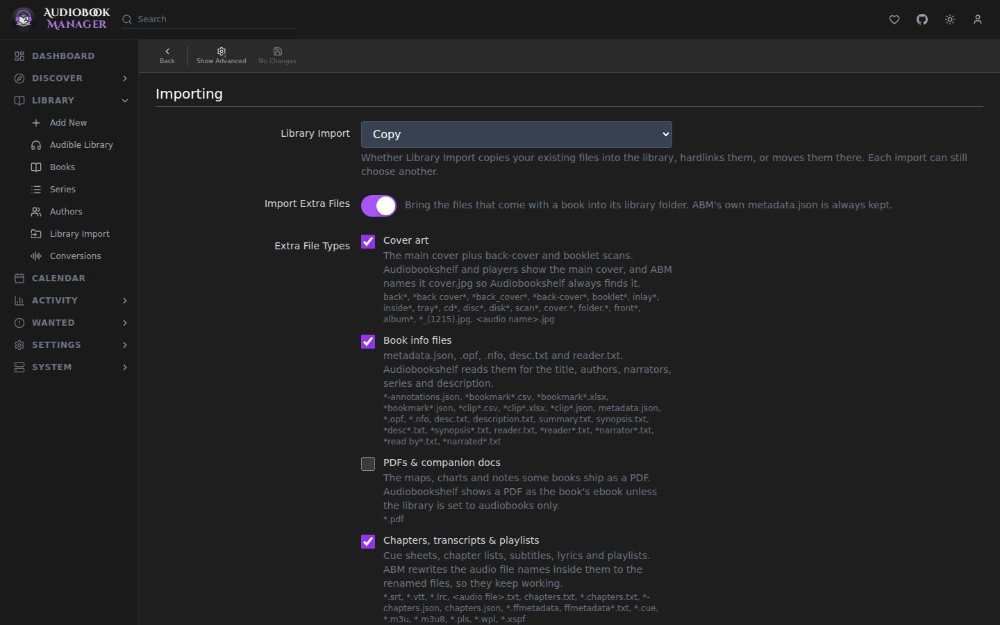

**Settings > Media Management** controls where books live and how files move in. Settings marked advanced appear with **Show Advanced**.

## Root Folders

A root folder is a directory ABM manages books in. Add one with **Add Root Folder**, which opens a folder browser with a typeable path. ABM can also list unmapped folders under a root and import them. A root's free space and hardlink support are checked when it is added. Removing a root asks what to do: **Remove from ABM only** (the default) forgets the books under it and leaves the files, and **Delete the books and their files** permanently deletes everything under the path without using the recycling bin. A root with books in it makes you type to confirm. Removing a root also deletes any auto-tag rule condition that named it.

Root folders can't be nested. Adding one that sits inside another root, or that contains one, is refused with HTTP 400 naming the other root. If you already have a nested pair, System > Status warns and names both paths. A book counts under, and is removed with, the most specific root that holds it, so removing the outer root leaves the inner root's books alone, and **Delete the books and their files** is refused while another root lies inside the one you're removing.

The default root folder is the one new books go to and the one that decides whether hardlink is offered for Library Import.

## Folders

| Setting | Default | Effect |
|---|---|---|
| Create Empty Book Folders | off | Creates missing book folders on add, on root folder change and during a disk scan. Ignored while **Delete empty folders** is on, so a folder is not made only to be removed. |
| Delete empty folders | off | Deletes empty book folders during a disk scan and when book files are deleted |

## Importing

| Setting | Default | Effect |
|---|---|---|
| Skip Free Space Check | off | For when ABM cannot detect free space on a root |
| Minimum Free Space | 100 (MB) | An import that would leave less than this is refused |
| Use Hardlinks instead of Copy | on | For completed downloads: hardlink instead of copy, so seeding does not double the space. Needs the same volume. |
| Library Import | Copy | The default for [Library Import](/library-import/): copy, hardlink or move. Hardlink is grayed out until the default root has been checked and supports it. |
| Import Extra Files | on | Master switch for bringing non-audio files along. Applies to Library Import, Manual Import and completed downloads |
| Extra File Extensions (advanced) | empty | More file types to bring along, kept under their own names, for example `srt, lrc`. With or without the dot, separated by commas or spaces. Blocked types, such as executables and partial downloads, can't be saved. Disabled while **Import Extra Files** is off |
| Preferred Cover (advanced) | Matched | Matched edition's cover, or the folder's best image, when both exist |

**Import Extra Files** brings a book's other files along with its audio. Five switches pick which kinds come along, and a file matching **Extra File Extensions** comes along even when its kind is switched off:

| Switch | Default | Covers |
|---|---|---|
| Cover art | on | Cover plus back-cover and booklet scans |
| Book info files | on | metadata.json, .opf, .nfo, desc.txt, reader.txt |
| PDFs & companion docs | off | PDFs shipped with a book |
| Chapters, transcripts & playlists | on | .cue, chapter lists, subtitles, lyrics, playlists. File names inside them are rewritten to the renamed audio. |
| Audible originals & ebooks | off | .aax/.aaxc, vouchers, epub and similar |

Partial downloads and executables are never imported. ABM's own `metadata.json` is always handled by ABM.

Hardlink is not the same as **Use Hardlinks instead of Copy**. That one is for downloads. The Library Import default is only what the Add to Library dialog preselects.

## File Management

| Setting | Default | Effect |
|---|---|---|
| Unmonitor Deleted Books | off | A book deleted from disk is unmonitored |
| Change File Date | None | Changes file dates on import and rescan |
| Enable Recycling Bin | on | Deleted book files move to a bin instead of being deleted |
| Recycling Bin | empty | Where the bin is. Empty uses ABM's default (`/config/recycle/media`) |
| Recycling Bin Cleanup | 7 (days) | 0 disables automatic cleanup |
| Library Scan Interval | 24 (hours) | Hours between automatic scans. Choices are Disabled, every hour, 6, 12 or 24 hours, or weekly |
| Watch for Changes | on | Scan when files are added, removed or changed. A root folder the system can't watch, such as one past the inotify watch limit, is logged and skipped instead of stopping startup |
| Cover Cache Workers | 4 | How many covers are downloaded at once when caching artwork, from 1 to 16 |

A scan or refresh treats file extensions in any case (`Chapter 1.MP3`) and files at any depth (`Disc 1/`, `Disc 2/`) as the book's audio. A book is left alone when its files can't be read, or when its tracked files still exist somewhere other than the folder searched: nothing is changed, a single-book refresh says "Some files could not be read; book left untouched.", and a library scan counts the book as skipped. A root folder that doesn't answer within 10 seconds is treated as unusable instead of being waited on.

## Quality Upgrades

| Setting | Default | Effect |
|---|---|---|
| Automatic Upgrade Search | on | Periodically searches for better releases of downloaded books still below their cutoff. A copy replaces yours only when it is a real upgrade. |
| Upgrade Search Interval | 24 (hours) | How often it runs |

## Permissions (advanced)

| Setting | Default | Effect |
|---|---|---|
| Set Permissions | off | Run chmod on import and rename |
| chmod Folder | 755 | Octal mode for folders and files, without execute bits for files |
| chown Group | empty | Group name or gid. Use a gid on remote file systems |

## Gotchas

- If the recycle bin is enabled but its folder is unavailable, deletes that need it fail instead of deleting permanently.
- Hardlinks only work inside one filesystem. Files that cannot be linked are copied, never moved, and counted in the import result.

## File names

Rename Files, Library Import, Manual Import, Audible downloads and conversions all build a book's file name in one place, so they agree: `Title - (Part 01) - (2020) - (MP3).mp3`. A one-file book has no part. A multi-file book gets `Part 01`, `Part 02` and so on in listening order, padded to the width of the file count, and the extension is lowercase. A rename where files trade names, or shift by one, goes through without losing any. A multi-part book imported under an older layout, or with an upper-case extension, shows as needing a rename the next time Rename runs.

Names are cut to fit the 255-byte filename limit. The title is shortened, never the part number or the extension, and split chapter files, sidecars named after the audio and a folder's ` [ASIN]` tag get the same treatment.

If you know Sonarr: this is Sonarr's Media Management without naming formats. Folder names are chosen by ABM. Bulk rename lives on Library, Series and Authors as **Rename Files**.
