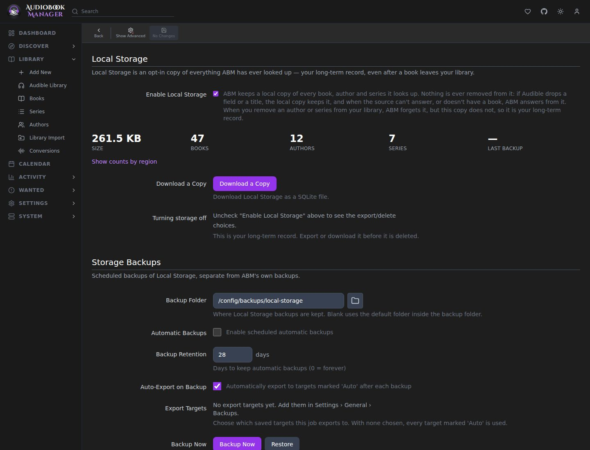

**Settings > Metadata** decides what ABM writes into a book's folder and its files. How these files are used is on [Sidecar files](/using/sidecars/).

## Source

**Metadata Source** is Built-in (the default), Hosted (libexdb.com) or Self-hosted, which takes a **Server URL**. **Test** makes a real request to the selected source without saving, **Status** says whether it is ready, and **Connection** shows the route lookups leave through and links to **Settings > Network**. Switching takes effect for every lookup at once. See [Choosing a metadata source](/metadata/choosing-a-source/).

## Metadata File Creation

| Setting | Default | Effect |
|---|---|---|
| Create on Book Add | off | Write files when a book is added as wanted |
| Create on Import | on | Write files when an audiobook is imported |
| Create on Refresh | off | Create or update files when metadata is refreshed |
| Overwrite Existing | off | Replace files already in the folder |

Under **Files to Create**, all on: **Cover image** (`cover.jpg`), **Book info** (an `.opf` named after the first audio file, compatible with Audiobookshelf), **Description** (`desc.txt`) and **Narrator** (`reader.txt`). **Create on Refresh** shows with **Show Advanced**.

## Audio file tag writing

Writes audio tags into the audio files themselves.

| Setting | Default |
|---|---|
| Write Audio Tags | off |
| Write Audio Tags on Import | on, once tag writing is on |
| Write Audio Tags on Refresh | off |

Tag fields, all on by default: Title, Artist (Author), Album Artist (Author), Album (Title/Series), Genre, Year, Comment (Description), Narrator (Composer) and Cover Art.

## Local Storage

**Enable Local Storage** is off by default and is there for every metadata source. Once it is on, ABM saves every book, author and series a lookup returns, taken from the answers it receives, into a file of its own. It shows the file's size and how many books, authors and series it holds. The totals cover every region, with a breakdown by region when more than one region has data. A file that can't be opened is reported there and never stops lookups. How it is used is on [Your metadata, your control](/metadata/control/#local-storage).

**Download a Copy** saves the library as a single SQLite file.

Turning it off opens a dialog. You can pick any combination of two optional copies, or neither:

- **Export to backup targets.** Sends the library to your export targets.
- **Download a copy.** Saves the library as a SQLite file.

Then you pick one of two choices, which is required:

- **Keep the local data.** It stays, and is used again the next time you turn Local Storage on.
- **Delete it.** Deleted Local Storage can't be recovered unless you made a copy.

If the export or the download fails, nothing is deleted and Local Storage stays on.

## Storage Backups

Shown while Local Storage is on. These backups are separate from the ABM backups under [Backups](/system/backups/).

| Setting | Default | Effect |
|---|---|---|
| Backup Folder | blank | Where they are kept. Blank uses the default folder inside the backup folder |
| Automatic Backups, schedule | off, daily | Work like the schedule under [General](/settings/general/#backups) |
| Backup Retention | 28 days | Age at which automatic backups are removed. 0 keeps them forever. Manual backups are kept |
| Auto-Export on Backup | on | Send each backup to the export targets after it is made |
| Export Targets | none picked | Pick the saved targets to use. With none picked, every target marked **Auto** is used |

The targets are the ones saved under General > Backups. If every target you picked is deleted, the export turns off instead of going to all of them.

**Backup Now** runs one straight away. The list shows each backup with **Download**, **Export**, **Restore** and **Delete**. **Restore from a file** takes a backup you uploaded. Delete always asks you to confirm. Restore asks for your account password when one is set. A restore that fails leaves the current library as it was. If a backup is already gone, or an export can't reach its target, the action reports the reason instead of failing quietly, and nothing else is touched.

The Tasks page shows the job as **Local Storage Backup**. An ABM backup carries the Local Storage switch and its backup schedule, not the stored lookups, so restoring one turns Local Storage back on without bringing the library back.

## Gotchas

- Tag writing changes the audio files. Audiobookshelf will see them as modified.
- If metadata or a cover cannot be fetched during tag writing, the call returns warnings instead of failing.
- When a cover could not be embedded because the connection refused it, the book page and the edit dialog show a warning instead of plain success.
