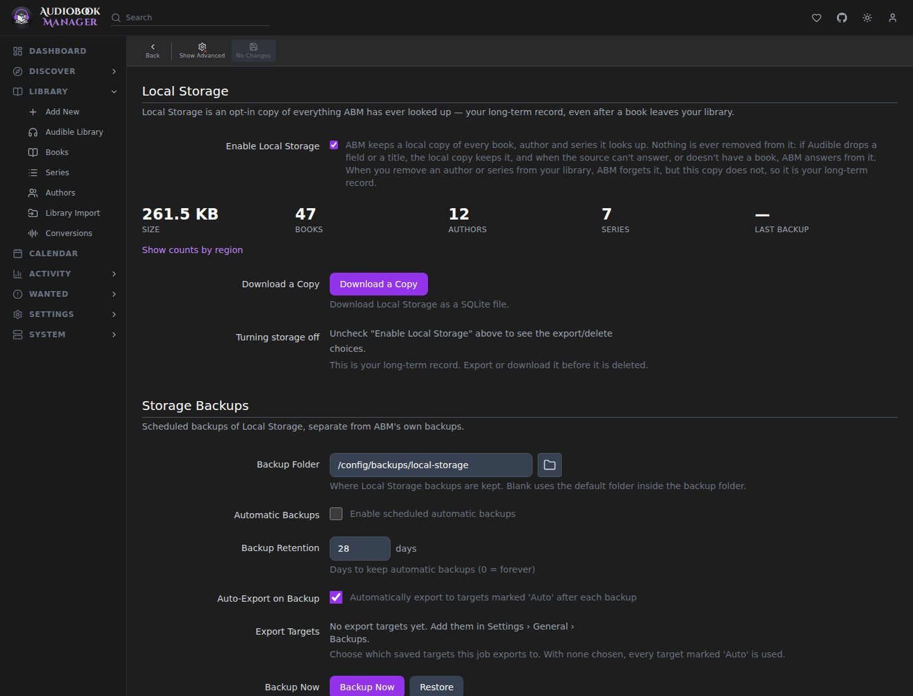
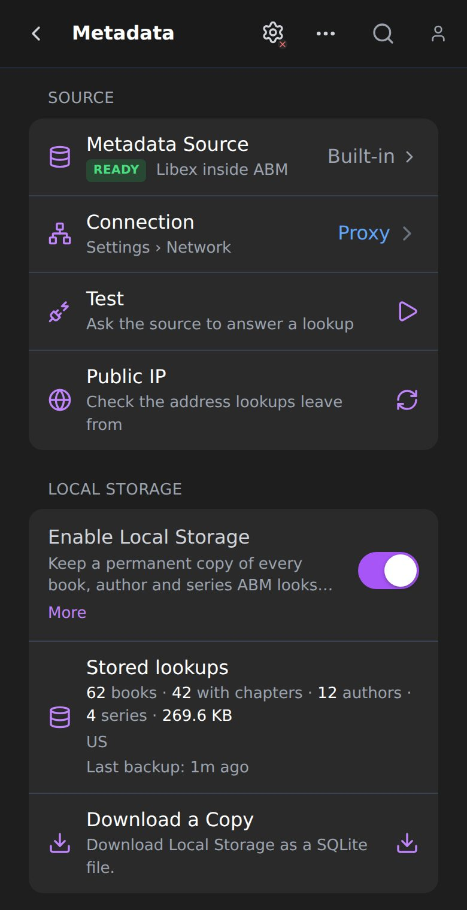

**Settings > Metadata** decides where ABM looks books up, whether it keeps its own copy of every lookup, and what it writes into a book's folder and its files. How these files are used is on [Sidecar files](/using/sidecars/).

## Source

The section opens with cards for **Source**, **Status** and **Connection**. **Metadata Source** is Built-in (the default), Hosted (libexdb.com) or Self-hosted, which takes a **Server URL**. **Test** makes a real request to the selected source without saving. **Status** says whether it is ready, or shows Unsaved when you have picked a source but not saved yet. **Connection** shows the route lookups leave through (Server for Hosted and Self-hosted) and links to **Settings > Network**. **Public IP** has a **Check** button that shows the address your lookups leave from. On a phone these are rows, like the Settings menu, with the source picked from a list. Switching takes effect for every lookup at once. An install that used Hosted before shows Built-in until you pick Hosted again. See [Choosing a metadata source](/metadata/choosing-a-source/).

## Local Storage

**Enable Local Storage** is off by default and is there for every metadata source. Once it is on, ABM saves every book, author and series a lookup returns, taken from the answers it receives, into a file of its own. It shows cards for **Books**, **Chapters** (books with chapters), **Authors**, **Series** and **Size**, and when it was last backed up. On a phone the counts sit in one **Stored lookups** row, and a count that can't be read shows a dash instead of 0. The totals cover every region, and the regions that hold data are named under them. A file that can't be opened is reported there and never stops lookups. How it is used is on [Your metadata, your control](/metadata/control/#local-storage).

Turning it on starts keeping lookups once you save. **Download a Copy** saves the library as a single SQLite file. It works once something is stored and the file can be read.

Turning it off opens a **Turn Off Local Storage** dialog with three optional checkboxes:

- **Export to backup targets first.** Sends the library to your export targets.
- **Download a copy first.** Saves the library as a SQLite file.
- **Delete Local Storage.** Deleted Local Storage can't be recovered unless you made a copy.

With none ticked, **Turn Off** keeps the local data, and it is used again the next time you turn Local Storage on. Ticking Delete changes the button to **Turn Off and Delete** and asks you to type `delete` before it works.

If the export or the download fails, nothing is turned off or deleted and Local Storage stays on.

## Storage Backups

Shown while Local Storage is on. These backups are separate from the ABM backups under [Backups](/system/backups/).

| Setting | Default | Effect |
|---|---|---|
| Backup Folder | blank | Where they are kept. Blank uses the default folder inside the backup folder |
| Automatic Backups, schedule | off, daily | Work like the schedule under [General](/settings/general/#backups) |
| Backup Retention | 28 days | Age at which automatic backups are removed. 0 keeps them forever. Manual backups are kept |
| Auto-Export on Backup | on | Send each backup to the export targets after it is made |
| Export Targets | none picked | Pick the saved targets to use. With none picked, every target marked **Auto** is used |

The targets are the ones saved under General > Backups. If every target you picked is deleted, the export turns off instead of going to all of them.

**Backup Now** runs one straight away while Local Storage can be read. The list shows each backup with **Download**, **Export**, **Restore** and **Delete**. **Restore**, beside **Backup Now**, takes a backup file you upload. Delete always asks you to confirm. Restore asks for your account password when one is set. A restore that fails leaves the current library as it was. If a backup is already gone, or an export can't reach its target, the action reports the reason instead of failing quietly, and nothing else is touched. If the backup folder can't be read, the page still opens and shows the last backup as never.

The Tasks page shows the job as **Local Storage Backup**. An ABM backup carries the Local Storage switch and its backup schedule, not the stored lookups, so restoring one turns Local Storage back on without bringing the library back.

## Files

Sidecar files and audio tags.

### Metadata File Creation

| Setting | Default | Effect |
|---|---|---|
| Create on Book Add | off | Write files when a book is added as wanted |
| Create on Import | on | Write files when an audiobook is imported |
| Create on Refresh | off | Create or update files when metadata is refreshed |
| Overwrite Existing | off | Replace files already in the folder |

Under **Files to Create**, all on by default: **Cover image** (`cover.jpg`), **Book info** (an `.opf` named after the first audio file, compatible with Audiobookshelf), **Description** (`desc.txt`) and **Narrator** (`reader.txt`). `metadata.json` and an `.nfo` are always written and have no setting; they show on the page as always-written rows. **Create on Refresh** and **Write Audio Tags on Refresh** show with **Show Advanced**.

### Audio File Tag Writing

Writes audio tags into the audio files themselves. Tag writing is on by default, so an import writes the tags unless you turn it off.

| Setting | Default |
|---|---|
| Write Audio Tags | on |
| Write Audio Tags on Import | on, once tag writing is on |
| Write Audio Tags on Refresh | off |
| Write Audio Tags to Hardlinked Files | off |

**Write Audio Tags to Hardlinked Files** shows once tag writing is on and covers an audio file hardlinked to your download client. Off, ABM writes no tags or cover into those files and leaves them as they are. On, ABM gives each one its own copy before writing, so the book uses its full size on disk a second time. See [Sidecar files](/using/sidecars/#hardlinks).

The **Tag Fields** show once **Write Audio Tags** is on, all on by default: Title, Artist (Author), Album Artist (Author), Album (Title/Series), Genre, Year, Comment (Description), Narrator (Composer) and Cover Art.

## Gotchas

- Tag writing changes the audio files. Audiobookshelf will see them as modified.
- If metadata or a cover cannot be fetched during tag writing, the call returns warnings instead of failing.
- When a cover could not be embedded because the connection refused it, the book page and the edit dialog show a warning instead of plain success.
