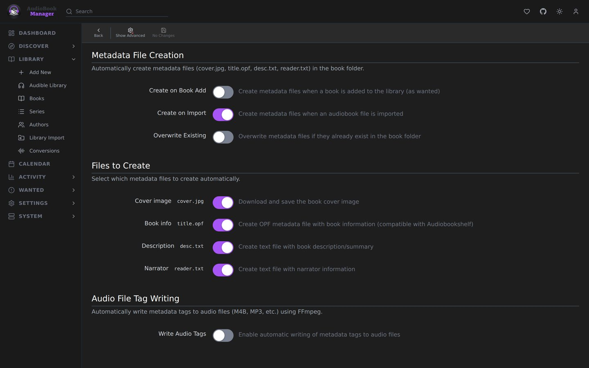

**Settings > Metadata** decides what ABM writes into a book's folder and its files. How these files are used is on [Sidecar files](/using/sidecars/).

## Metadata File Creation

| Setting | Default | Effect |
|---|---|---|
| Create on Book Add | off | Write files when a book is added as wanted |
| Create on Import | on | Write files when an audiobook is imported |
| Create on Refresh | off | Create or update files when metadata is refreshed |
| Overwrite Existing | off | Replace files already in the folder |

Under **Files to Create**, all on: **Cover image** (`cover.jpg`), **Book info** (an `.opf` named after the first audio file, compatible with Audiobookshelf), **Description** (`desc.txt`) and **Narrator** (`reader.txt`). **Create on Refresh** shows with **Show Advanced**.

## Audio file tag writing

Uses ffmpeg to write tags into the audio itself.

| Setting | Default |
|---|---|
| Write Audio Tags | off |
| Write Tags on Import | on, once tag writing is on |
| Write Tags on Refresh | off |

Tag fields, all on by default: Title, Artist (Author), Album Artist (Author), Album (Title/Series), Genre, Year, Comment (Description), Narrator (Composer) and Cover Art.

## Coming in a later release

A choice of metadata source and a local copy of the metadata library are planned for a later release. See [Your metadata, your control](/metadata/control/).

## Gotchas

- Tag writing changes the audio files. Audiobookshelf will see them as modified.
- If metadata or a cover cannot be fetched during tag writing, the call returns warnings instead of failing.
