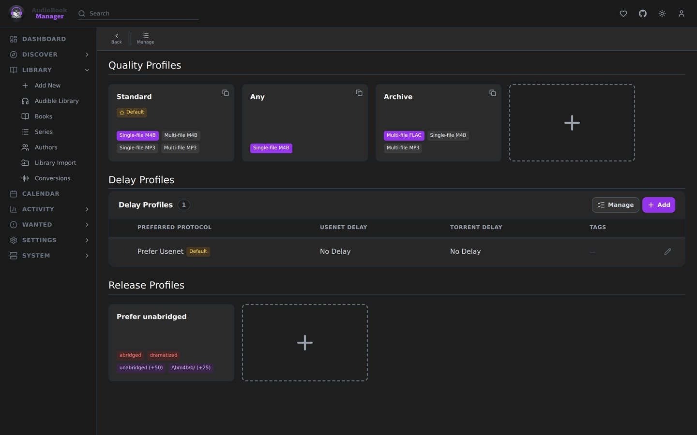
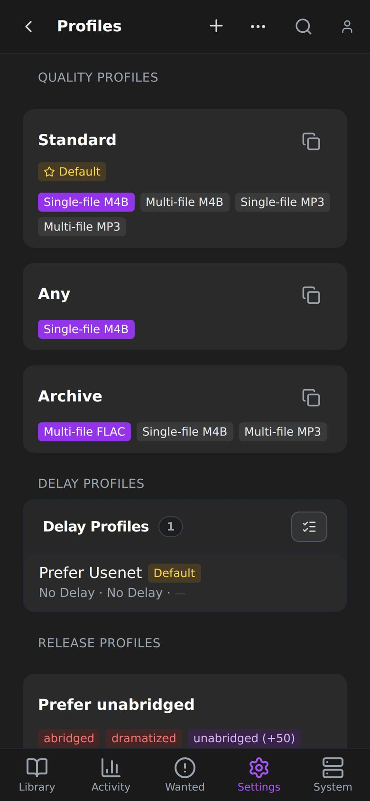

**Settings > Profiles** is one page with three sections. They answer three different questions about a release.

## Quality profiles

A quality profile is a ladder of formats, worst at the bottom to best at the top. A rung is a format (M4B, M4A, MP3, FLAC, OGG, Opus, AAC, WMA) in either a single-file or multi-file form. Rungs can be grouped so they rank equally, and a rung can be switched off.

| Setting | Meaning |
|---|---|
| Upgrades Allowed | If off, ABM will not replace a book once it has one |
| Upgrade Until | The cutoff. Once this quality is reached, ABM stops upgrading |
| Grab off-ladder formats | Grab a format not on the list rather than skip the book |
| Default profile | The profile used when nothing more specific applies |

One profile is the default. A book uses, in order, its own profile, its primary series' profile, its primary author's profile, then the default. A profile in use cannot be deleted.

A new copy replaces what you have only if the profile allows upgrades, the new rung is on the ladder and enabled, the book is below its cutoff, and the new rung ranks strictly higher.

If you know Sonarr: this is a quality profile where qualities are audio formats and file layout rather than resolution. Custom formats do not exist. [Release profiles](#release-profiles) cover similar ground.

There are no bitrate or size tiers: quality means format and file layout only. For a release, ABM takes the format from the indexer or the title and guesses the layout from the title (an M4B with no part or track numbers counts as single-file), then checks it again once the files are imported. The **Preferred Quality** on [Audible settings](/settings/audible/) is something else: the quality Audible downloads come in.

## Delay profiles

A delay profile holds a release back before grabbing, to give a better release time to appear.

| Setting | Meaning |
|---|---|
| Enable Usenet / Enable Torrent | Allow grabs from that protocol |
| Usenet Delay / Torrent Delay | Minutes to wait before grabbing a release of that protocol |
| Preferred Protocol | Which to prefer when both find a match |
| Bypass if Highest Quality | Skip the delay when a release already meets the profile's cutoff |
| Tags | The profile applies only to items with a matching tag |

Delay profiles are shown as a table, as in Sonarr.

## Release profiles

A release profile adds rules on top of quality.

| Field | Meaning |
|---|---|
| Enable Profile | On or off |
| Must Contain | The release must contain at least one term (case insensitive) |
| Must Not Contain | A release with any of these terms is rejected |
| Preferred | Terms that score a release up or down. Write `/regex/` to use a regular expression |
| Narration language | Restrict to a language |
| Indexer | Apply to one indexer, or any |
| Tags | Apply only to items with a matching tag |

Release profiles are shown as a table.

## Gotchas

- Profiles never delete files. They decide what to grab and what counts as an upgrade.
- Tags on a delay or release profile limit it to books that carry one of those tags.
