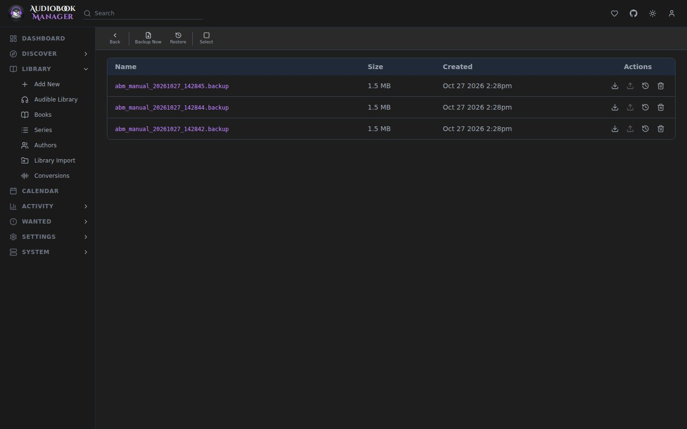

**System > Backups** creates and restores backups. **Backup Now** makes one. Schedules, retention and export targets are under [General](/settings/general/).

## What is in a backup

An encrypted archive with a consistent copy of the database (`database.db`), the settings (`settings.json`) and a manifest. Also include `/config` in your own backups for the covers and the app secret file.

## Restoring

Pick one from the list, or upload a backup file (up to 500 MiB). A copy of the live database is saved first. Restoring cannot be undone.

A restore asks for your current password, since it replaces the whole database. Only encrypted `.backup` files restore. Unencrypted backups from versions before 0.14 are no longer accepted, so make a new backup from a current install. The whole backup is checked before anything is replaced, and one that can't be restored without sending ABM back to first-run setup is refused untouched.

Only one restore runs at a time. A second one, from another tab or a double press of Enter, is refused with "A restore is already running." (HTTP 409).

By default a restore does not bring back **security settings** (authentication mode, credentials, trusted networks). Your current ones are kept and the result says so. The page has no switch for this. Only an API call to `restore-upload` with `restore_security_settings=true` brings them back, so an uploaded archive can never switch sign-in off just by being restored.

Restoring the security settings (through the API) signs out every session, so you sign in again. Open pages lose their live connection when that happens, and a tab you left open needs a reload. A restore that fails part way also closes open connections, since it may already have swapped the database.

Restoring a backup by name answers 404 if the file is not in the list. A backup that is refused or cannot be decrypted answers 400 with the reason, and the refusal is recorded in the [Activity Log](/system/activity-log/).

If the backup was made on an older version, restart the container after restoring so the migration runs.

A backup is refused, with nothing changed, if it holds unexpected entries, is not a valid SQLite database, or is a legacy backup from before the SQLite move.

## Export targets

SFTP, SCP, FTPS, FTP, S3 or an rclone remote. A target marked **Auto** receives each backup automatically. Rclone remote names may use letters, digits, `_`, `.` and `-`. The name stays as you type it and is checked against that rule as you go, with Connect disabled until it passes.

Each export and each **Test connection** (the check mark on a saved target) writes its own log file, which the result links to, even when it fails. See [Logs](/system/logs/).

### SFTP and SCP host keys

ABM trusts the server's host key the first time it connects, saves it on the target, and shows its fingerprint as **Host Key** in the target's dialog. Compare it with `ssh-keygen -lf` on the server. Later connections must offer the same key. If it differs, ABM refuses before sending the password, says which fingerprints it saw, and writes the refusal to the security log. If the change is expected, open the target, press **Forget host key**, confirm and save. The next connection trusts whatever the server presents. Changing the host, port or type of a target also drops the saved key.

## Gotchas

- The Docker image and your compose file are not in the backup. Keep the compose file.
- If you set `APP_SECRET`, back that up separately. Without it, stored credentials cannot be decrypted after a restore on another host.
