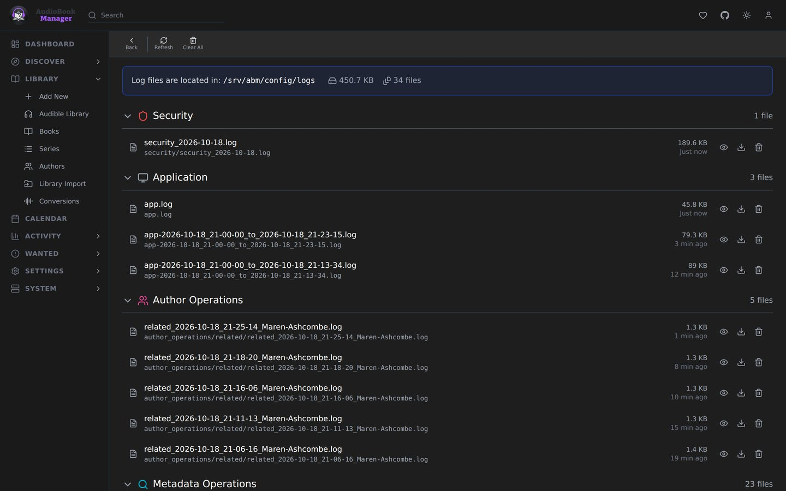

**System > Log Files** lists ABM's text logs. Open one to read it, download it, delete it, or clear them all. Logs appear as operations run.

- Open a log and turn on **Live** to follow it: the view keeps scrolling to the newest line, and scrolling up pauses that and scrolling back to the bottom resumes it. The whole file is always shown.
- Tasks and conversions write their own log. The Tasks page links each one.
- The main log is `app.log`. It rolls at start-up, at least hourly and at 10 MiB. Old files are kept for **Log File Retention** (30 days by default).
- A separate security log carries one line per sign-in attempt for fail2ban and similar tools.
- Levels are set under **Settings > General > Logging**.

## Reading a problem

Start from the failed task's log button. It shows the operation from its start line to its end block. The text is redacted of secrets, but check before pasting a log in public.

## Gotchas

- SQL Logging and Debug levels are verbose. Turn them off when done.
- Deleting a log, or clearing them all, asks you to type `delete` to confirm.
- Deleting a log leaves activity entries that link to it. They read "Log no longer kept".
