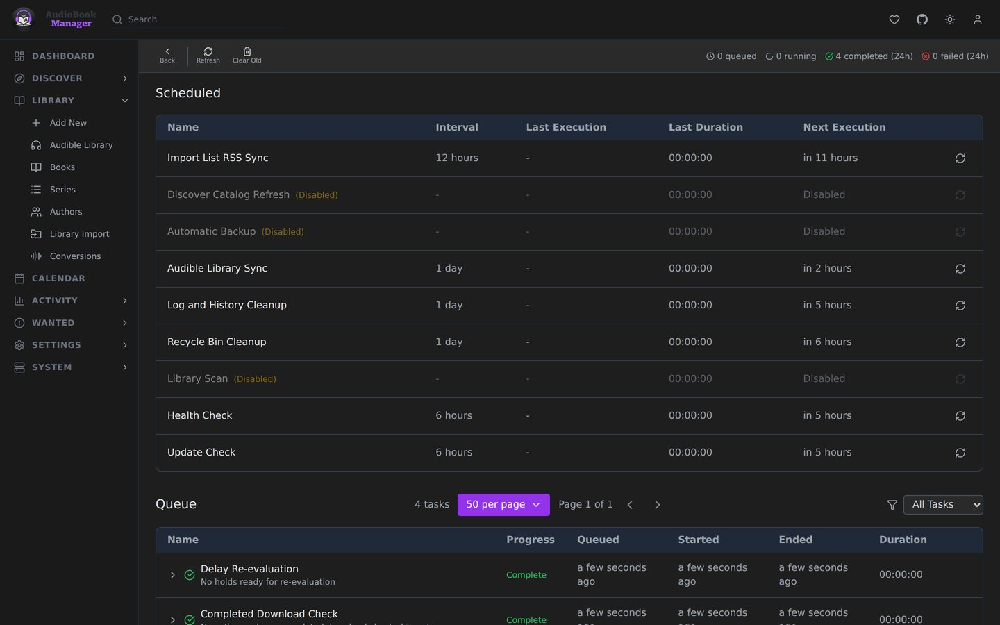

**System > Tasks** lists everything ABM does in the background: library scans, refreshes, imports, searches, downloads, syncs, backups. Each row shows its state (waiting, running, completed, failed), progress, result and a log button.

- A task that completed with entries in its error list shows as **Partial**. Expand it for each skipped item and the reason.
- A task with a retry coming stays as waiting until retries run out. The attempt number is shown.
- **Clear completed tasks older than 24 hours** tidies the list. Old tasks are also cleaned automatically (30 days by default).
- Scheduled runs that did nothing appear here but not in the [Activity Log](/system/activity-log/).

## Gotchas

- Conversions are a separate queue. See [Conversions](/using/conversions/).
- The download sweeps (pending grab retry and completed download check) queue only while at least one download client is enabled, so the page does not fill with empty runs.
