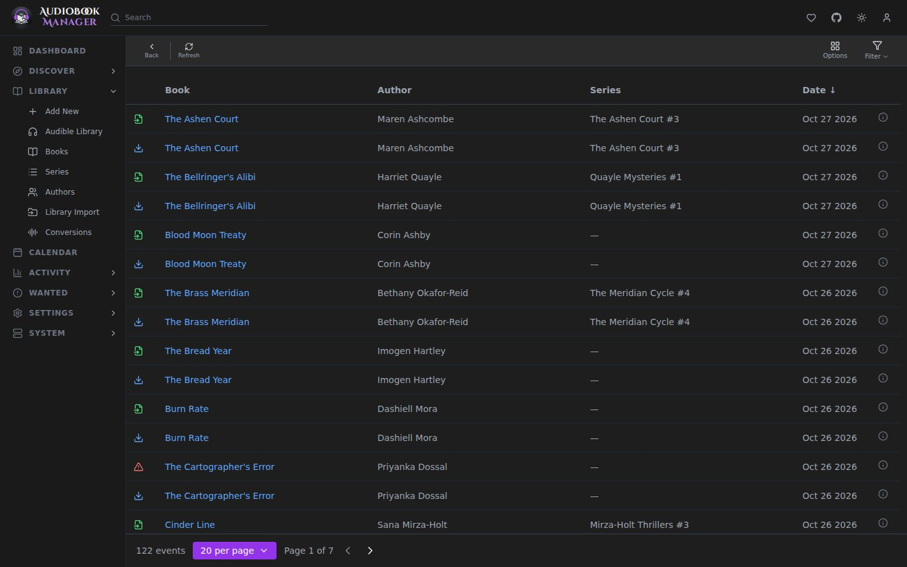

## Queue

What your download clients are working on. Row actions include **Grab now**, **Import Now**, **Manual Import** and **Retry Now**, and **Configure remote path mapping** when a finished download sits in a path ABM cannot see.

**Check for Imports** in the toolbar checks every completed download for something to import, or only the selected rows when some are selected. A row's **Import Now** imports just that row, and the result says how many of the ones you picked were not ready. A failed import, remove, retry or grab shows a toast with the server's reason.

Removing a row from the queue follows **Queue Page Remove Action** in the download client's settings: dismiss from ABM only, remove from the client and keep files, or remove from the client and delete files. See [Download Clients](/settings/download-clients/).

## History

Grabs, imports, failures and upgrades. A failed grab says which clients were tried.

## Blocklist

Releases ABM will not grab again, usually because they failed. **Remove from Blocklist** lets one back in. **Redownload Failed** in download handling adds a failed release here and searches again.

## Not the same as Events

These pages are about downloads. The system-wide record of what happened in ABM is the [Activity Log](/system/activity-log/).
