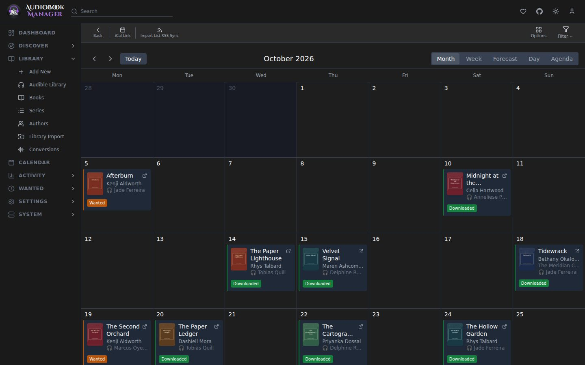
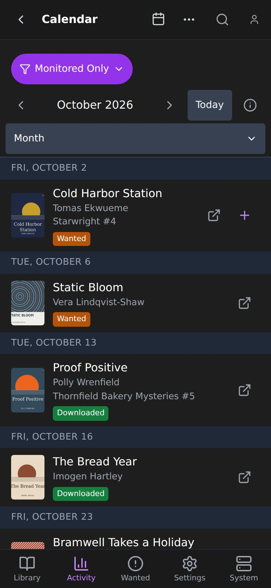

**Calendar** shows release dates of the books ABM knows about, colored by status. Views are month, week, forecast, day and agenda. The week starts on **First Day of Week** and the week view's headers use **Week Column Header**, both from [UI settings](/settings/ui/); the Calendar has no start-of-week or time format option of its own. A failed load shows an error with a Retry button instead of an empty month. A book that was downloaded but has no files left shows as Missing Files, the same as in the Library, and the legend has its colour.

## Options

The **Calendar Options** button offers: collapse multiple books releasing on the same day, color the whole event with the status color, and show author and series information.

You can also build a custom filter for the calendar. See [Custom filters](/using/library/#custom-filters).

## iCal feed

Subscribe from a calendar app with the feed URL (copy it, or use **Subscribe in Calendar App**). Options:

- **Include Unmonitored**: include unmonitored books in the feed.
- **Show as All-Day Events**: events are all-day.
- Tags: the feed then contains only books with at least one matching tag.

The feed URL carries your API key as `apikey=`, which is how a calendar app gets in without signing in. It works from outside your network when the calendar app can reach ABM. Anyone with the URL can use ABM's API, and the Calendar page warns about this: a cloud calendar such as Google holds the URL on its servers. Subscribe only from an app you trust, or keep the feed on your own network. If a URL leaks, regenerate the key under **Settings > General > Security**, then copy the subscribe URL again, because the old one stops working. See [Security and sign-in](/settings/security/).
