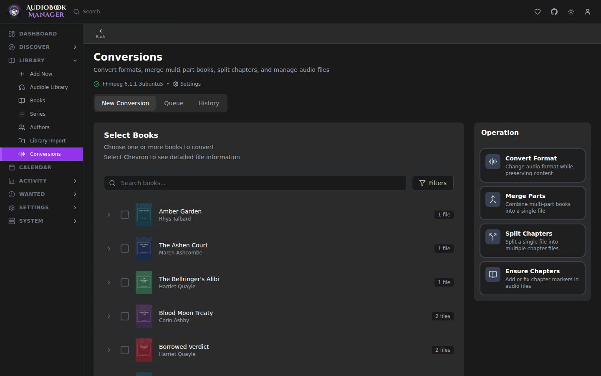

**Library > Conversions** runs ffmpeg jobs on your library. Four kinds:

| Job | What it does |
|---|---|
| Convert Format | Re-encodes to M4B, MP3, M4A, FLAC or Opus |
| Merge Parts | Combines several files into one, with chapters |
| Split Chapters | Splits one file into a file per chapter |
| Ensure Chapters | Adds or fixes chapter markers without re-encoding |

Defaults for every job come from [Conversion settings](/settings/conversions/). Each job can override them.

## The queue

Jobs wait in a queue and run up to **Concurrent Conversions** at a time (2 by default). Finished jobs move to History, which you can clear.

Output is written to a private work folder and placed in the library only when finished. Each file goes in under a temporary name and is renamed into place, so a half-written book never shows up. A free-space check runs before a job starts and again before placement. Source files are never overwritten.

Converting a file to the format it is already in is refused, because it would overwrite the original.

## After a conversion

ABM refreshes the book's file records, size and quality, so a converted book shows its new quality. If **Delete Original** is on, the old files go to the conversion recycle bin when that is enabled.

If placing the result fails (the library folder is full, say), the job fails and the finished output is kept in its work folder. The error names the folder. **Retry** starts the job over and discards that kept output, so it asks first. **Clear history** keeps jobs that still hold unplaced output.

## Restart, cancel and duplicates

A book can have one queued, running or paused job for each kind of job at a time. Starting another, from a button, a bulk request or Retry, is refused with "A conversion for this book is already queued or running", and a bulk request skips that book and lists the reason. If a job can't be handed to the queue, it is marked failed with "The conversion could not be queued" instead of sitting there waiting.

**Cancel** stops a waiting, running or paused job. **Restart** starts a job over from scratch as a new job with the same settings. It works on a waiting, running, paused or cancelled job, from its row on the Conversions page or the phone sheet, and it asks first because the old job is cancelled and its unfinished output is discarded. The old job stays in History. A failed job has **Retry**, and a finished one can't be restarted. The toast after you start a conversion from a book has Pause, Resume and Cancel for each of its jobs.

## Pause and resume

Two kinds of pause, neither of which cancels anything:

- **Pause** on one running job suspends its ffmpeg processes where they are. Resume continues from the same point.
- **Pause queue** (top of the queue, or the top bar on a phone) stops new jobs from starting and suspends every running job.

A job you paused yourself stays paused when the queue resumes, and across a restart. A job running when ABM stops comes back as paused and does not start by itself. Resume continues from the last finished part for merges, splits and multi-file converts. A single-file convert starts that file again.

The 6 hour run limit counts only unpaused time. If the saved queue state cannot be read at start-up, the queue starts paused and says so. Press Resume queue to rewrite it.

If you know Sonarr: there is nothing like this in the arrs. Think of it as a small encoder queue that happens to live inside the manager.

## Gotchas

- Concurrent Conversions times Threads Per Job should not exceed your CPU core count. On Auto, ABM splits the spare cores across the jobs running at once for you.
- A converted file has a new size and modified time, so Audiobookshelf will rescan it.
- Converting a file hardlinked to a seeding torrent creates a new file. The seeding copy keeps the old bytes.
