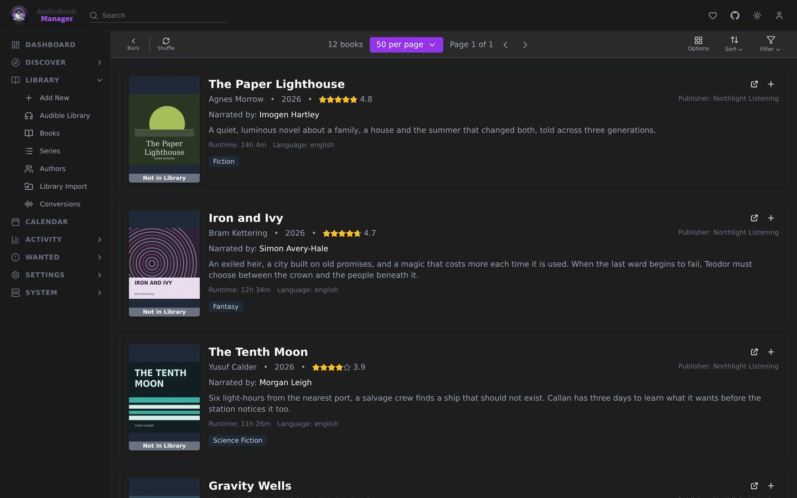
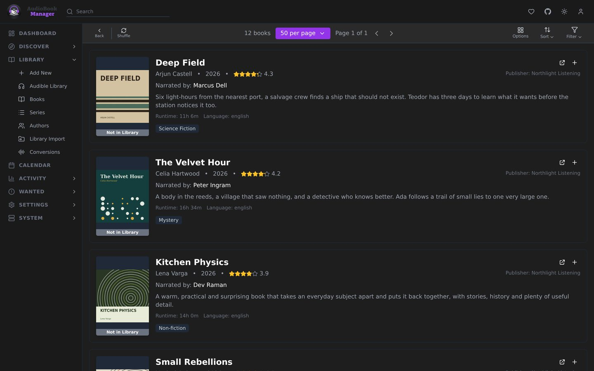

**Discover** has four pages: **Coming Soon**, **New Releases**, **Audible Best** and **Recommended**. ABM fills them by scraping Audible pages and fetching each book's details from Libex, and keeps the result so browsing is fast.

From any page you can add a book to the library. Recommended uses different genres each time it refreshes.

## Keeping it fresh

Refresh schedules and limits live in [Discover settings](/settings/discover/). If a catalog is empty, the page can refresh it for you once Libex is reachable.

## Gotchas

- The catalogs depend on Libex. If it is unreachable, refreshes are skipped and say why in the log.
- Discover shows what Audible lists. It says nothing about what your indexers carry.
