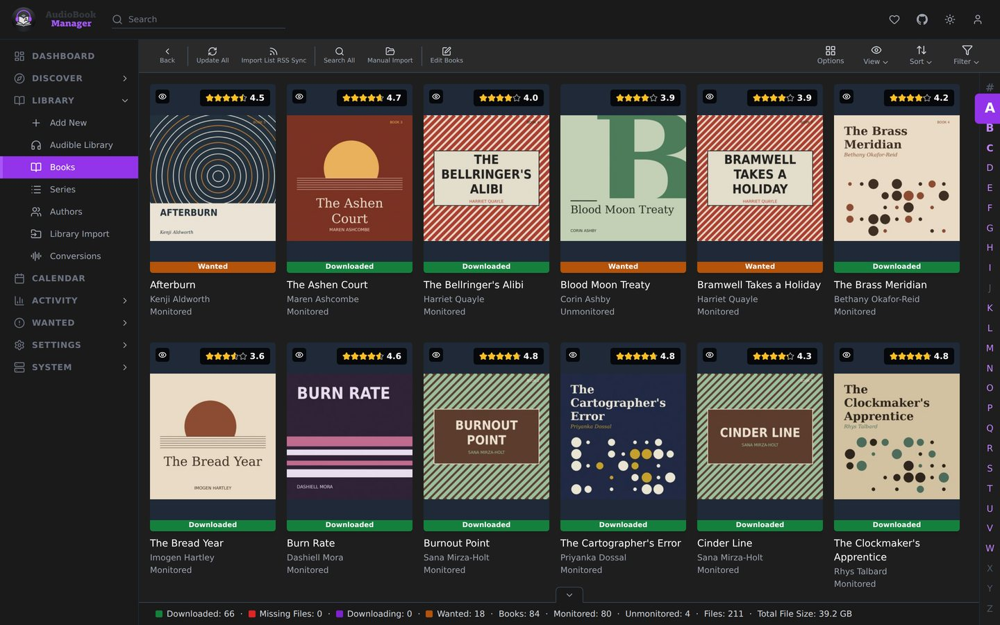
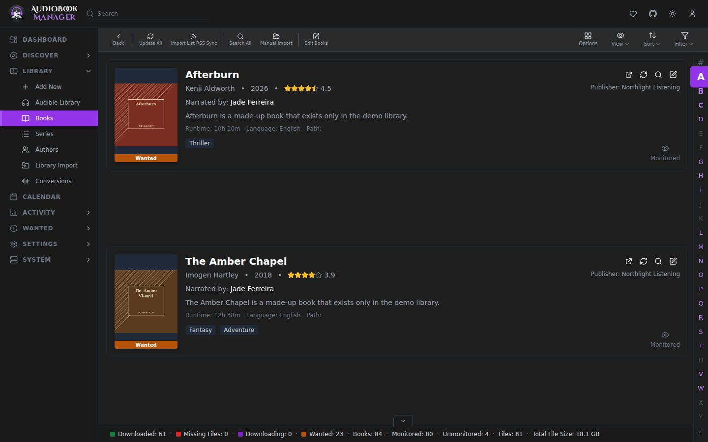
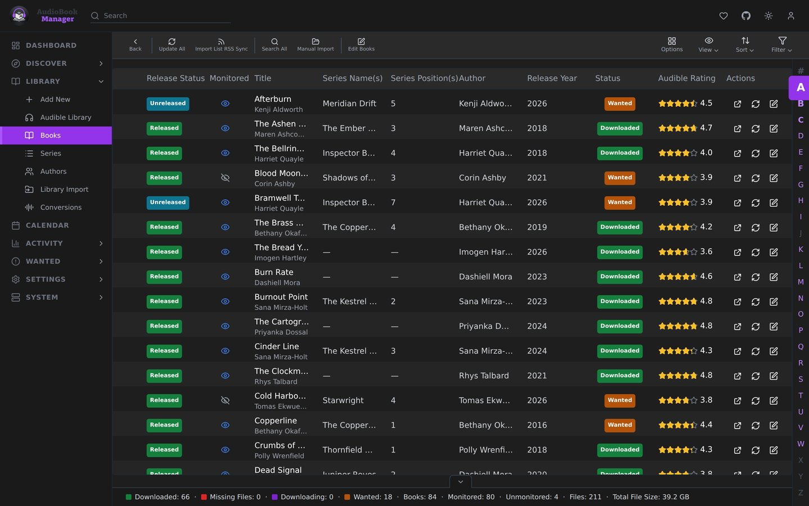
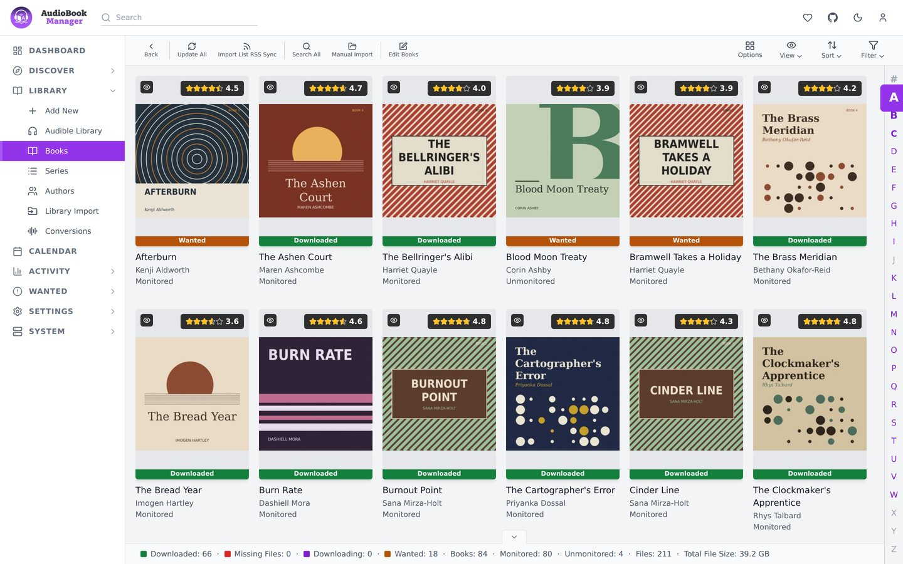
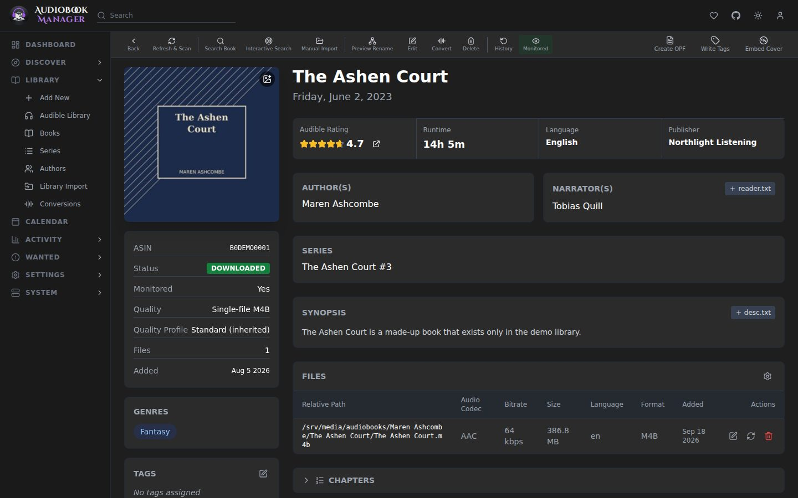
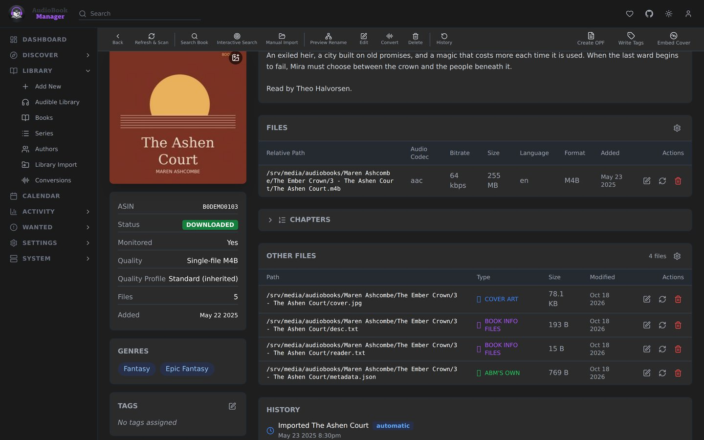
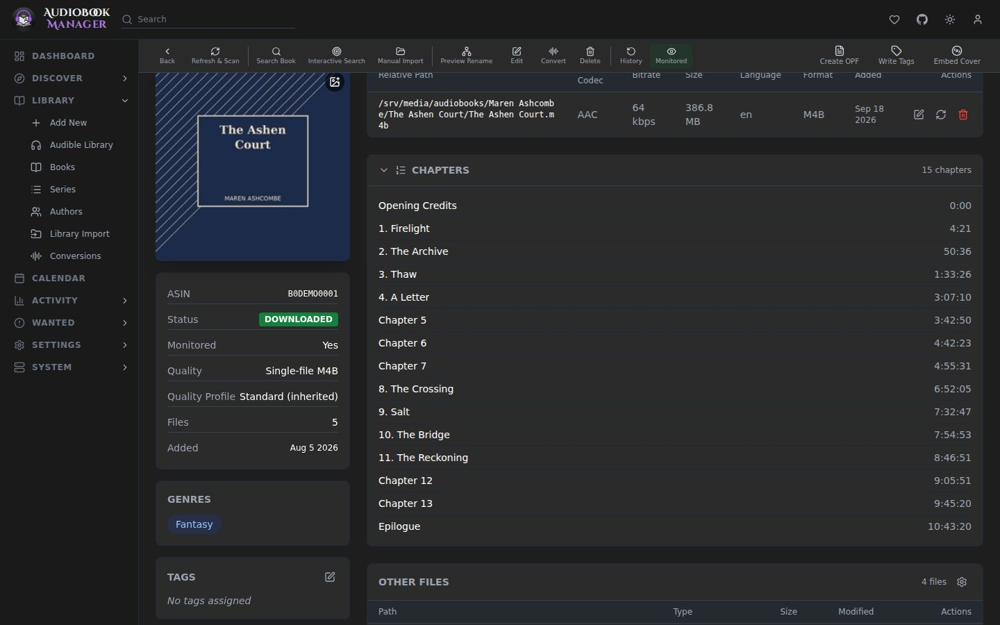
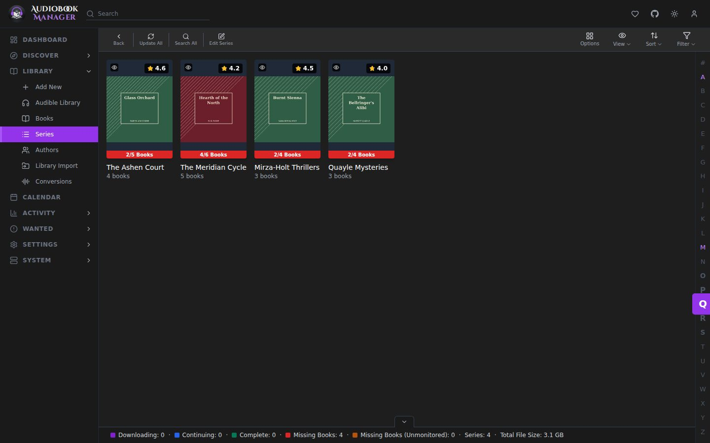
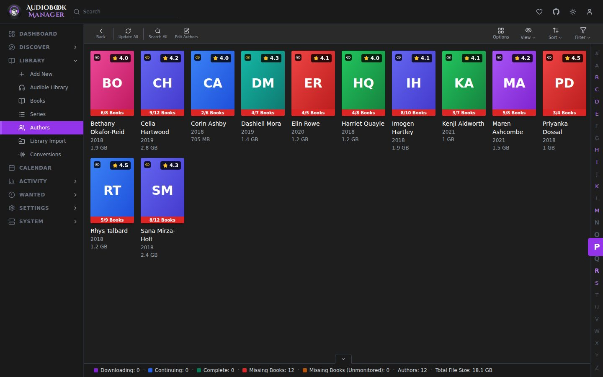
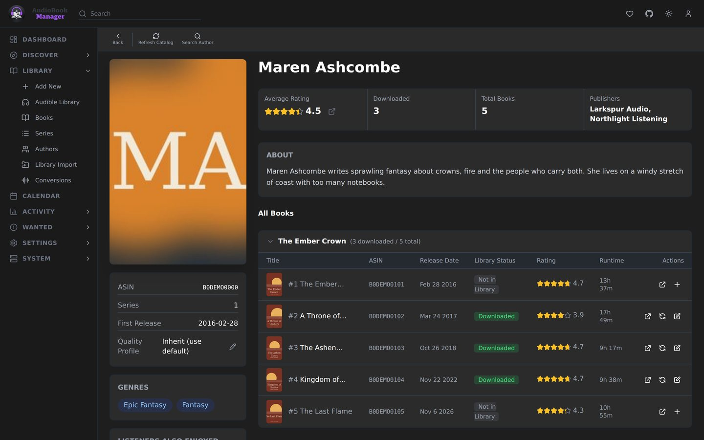

The **Library** menu has three lists: **Books**, **Series** and **Authors**. **Add New** and **Library Import** put things in them. **Audible Library** and **Conversions** are covered on their own pages.

## Books

Each book is an overview row, a poster or a table line (the view switch is in the toolbar). A book has a status:

- **Wanted**: monitored, no files yet. ABM searches for it.
- **Downloaded**: files are on disk.
- **Missing Files**: the book was downloaded, but its files are no longer where ABM expects them.
- **Unmonitored**: ABM leaves it alone.

Open a book for its detail page: files, metadata, history, the quality ABM measured, and actions such as Refresh & Scan and the edit dialog (see below). See [Sidecar files](/using/sidecars/).

If you know Sonarr: a book is an episode, a series is a season-and-show in one, and an author is a way to group both. The difference is that one book can belong to several series, and ABM uses the primary one (the lowest position) when it needs to pick.

## Series

**Library > Series** lists every series as Posters or Overview. Each shows a bar such as `3/7 Books`, coloured Downloading, Continuing (everything released is downloaded and more is coming), Complete, Missing Books or Missing Books (Unmonitored). The filter offers All, Monitored Only, Unmonitored, Missing and Wanted. A series page shows the whole catalog, including books you don't own. Filter it to All, In Library or Not in Library. **Add Remaining** or **Select to Add** brings the missing books in as wanted, and **Refresh Series** pulls the catalog again. **Monitor New Books** (All or None, chosen in the Add New dialog) decides whether books that come out later are added as wanted. See [Series tracking](/using/series-tracking/).

## Authors

**Library > Authors** lists authors as Posters or Overview, with the same progress colours as Series. The filter offers All, Has Books and No Books. An author page shows their catalog grouped by series, with downloaded and total counts for each series, plus their quality profile, genres and rating. **Refresh Catalog** pulls it again and **Search Author** searches for their wanted books. **Monitor New Books** works the same as for a series, and an author starts at None.

Deleting a series or author also deletes the books it has in the library. The dialog lists those books first, and flags any that are co-authored or also in another series. When there are books you type `delete` to confirm. Two boxes are off by default: one stops lists from adding these books again, and the other deletes the book folders and their contents from disk. Afterwards ABM removes any other author or series left with no books, except ones you added yourself.

## Quality profile inheritance

A book's quality profile comes from, in order: its own override, its primary series, its primary author, then the default profile. See [Profiles](/settings/profiles/).

## The edit dialog

The edit dialog on a book changes ABM's own settings for it, not its metadata:

- **Monitored**
- **Quality Profile** (No Change when editing several)
- **Path**, for one book (with a button to recompute it), or **Root Folder** for a selection
- **Tags**
- **Write to Directories**: cover.jpg, desc.txt, reader.txt and an OPF (the checkbox reads "metadata.opf"; the file is named after the book's first audio file, for example `Dune.opf`, or `title.opf` when there is no audio)
- **Write to Audio Files**: write metadata tags

The same dialog opens for series and authors and applies to each of their books. The write options run when you save.

## Tags

Books, authors and series can carry tags. Tags steer indexers, notifications, import lists and profiles, and filter the calendar feed. See [Tags](/settings/tags/).

## Selection

Select rows to act on several at once: monitor, search, tag, rename, delete. Deleting books shows the delete task's own progress and result, including how many it actually deleted, and refreshes the list in place. Typing `delete` is only asked for deletes that remove files or data for good, such as a series or author with their books, a single file on disk, or the Workbench's delete-these-files choice. Removing a tag, profile, indexer or list entry is a plain confirm. A refused or failed delete or removal (Series, Authors, Blocklist, Queue, a Library Import session) shows the server's reason in a toast. On a phone, see [Phone use](/phone/).
