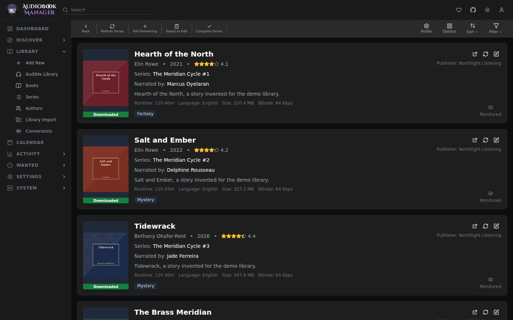

A series in ABM is a catalog: every book Libex knows in it, with the ones you own marked. It exists whether or not you own anything in it.

## Monitor New Books

Each series and author has a **Monitor New Books** choice, All or None. You set it in the [Add New](/using/add-new/) dialog when you add one, and again from the same dialog for one already in your library. It starts at All for a series and None for an author. When a refresh finds a book that was not in the catalog before, All adds it as wanted and None leaves it. The first time a catalog is built nothing counts as new. The choice is saved on the series or author, and refreshes apply it. The series and author pages don't show it.

## Filling gaps

Open a series and add its missing books. They enter as wanted with the profile and root folder you choose, and ABM searches for them like any other wanted book.

## Status you see

The Series list shows how many of each series' books are downloaded, as `3/7 Books`, with a colour for Downloading, Continuing, Complete or Missing Books. Open a series to see each book's own status, where a downloaded book with no files on disk reads Missing Files.

## Gotchas

- A series you added by hand stays, even with no books, until you remove it.
- Box sets with a range position such as "1-7" sort after books with a real number when ABM has to pick a primary series.
- Deleting a series also deletes the books it has in the library, after a confirmation that lists them. See [Library](/using/library/#authors).
