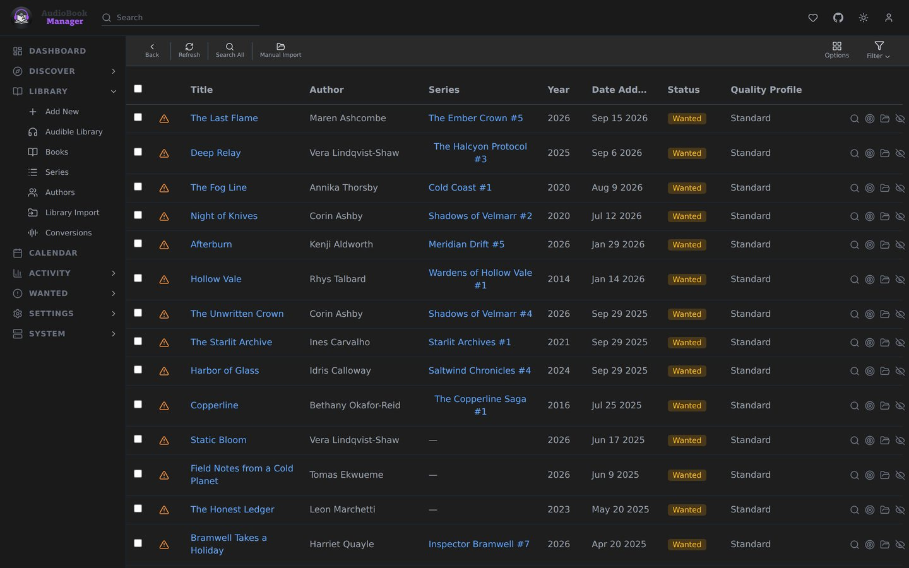
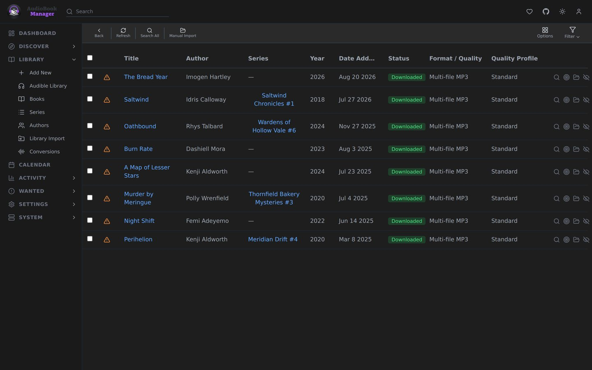

**Wanted** has two pages.

## Missing

Monitored books with no files. Per row: **Auto Search**, **Interactive Search**, **Manual Import**, **Unmonitor**.

- Auto Search asks every enabled indexer and grabs the best release the profiles allow.
- Interactive Search lists releases so you choose. A pick from here counts as a manual grab.
- Manual Import points ABM at files you already have.

ABM also searches missing books on its own. Releases are held by the delay profile before grabbing. See [Profiles](/settings/profiles/).

## Cutoff Unmet

Downloaded books whose quality is still below the cutoff of their profile ("Upgrade Until"). **Search All Cutoff Unmet** searches them. A better copy replaces the old one only when it ranks above it on the ladder.

**Media Management > Quality Upgrades** can run this search for you: **Automatic Upgrade Search** (on by default) every **Upgrade Search Interval** (24 hours by default). See [Media Management](/settings/media-management/).

If you know Sonarr: this is the same idea as Wanted > Cutoff Unmet, with a ladder of formats (M4B, MP3 and so on, single or multi-file) in place of resolutions.
